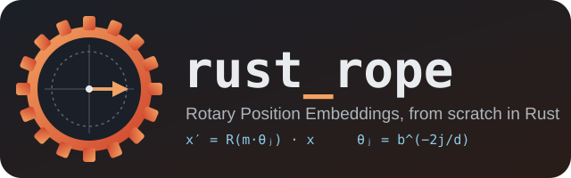
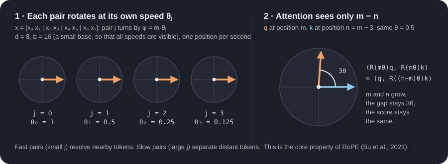
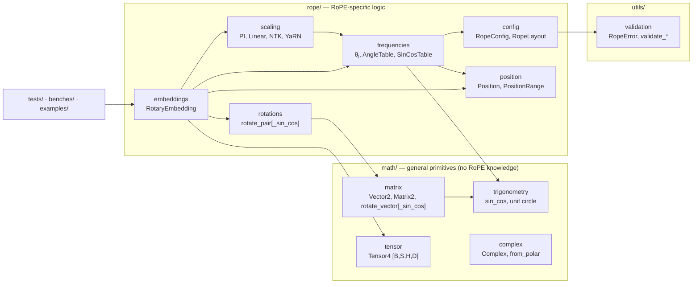

<p align="center">
  
</p>

<p align="center">
  
  
  
  
  
</p>

<p align="center">
  An educational, from-scratch implementation of <b>Rotary Position Embeddings (RoPE)</b> in Rust:<br>
  the mathematics, the layouts used by real models, long-context scaling, and measured CPU performance.
</p>

<p align="center">
  
</p>

---

## Contents

1. [What is RoPE?](#1-what-is-rope)
2. [What this project implements](#2-what-this-project-implements)
3. [Papers and methods replicated](#3-papers-and-methods-replicated)
4. [Quick start](#4-quick-start)
5. [Architecture](#5-architecture)
6. [CPU benchmarks (Stage 9)](#6-cpu-benchmarks-stage-9)
7. [Validation](#7-validation)
8. [Roadmap](#8-roadmap)
9. [Documentation and references](#9-documentation-and-references)

---

## 1. What is RoPE?

A **Transformer** processes a sequence of tokens. Each token becomes a
vector of numbers (an **embedding**). The **attention** operation compares
tokens with the dot product of a **query** vector `q` and a **key** vector
`k`. Attention by itself does not know the order of the tokens: "dog bites
man" and "man bites dog" look the same.

**Rotary Position Embedding (RoPE)** puts the position into the vectors
with a rotation. It splits a vector of dimension `d` into `d/2` pairs.
Pair `j` is a point in a plane. At the token position `m`, RoPE rotates
that point by the angle `m · θⱼ`:

```text
θⱼ = b^(−2j/d)                    one frequency per pair (b = 10 000 by default)

[x'₂ⱼ  ]   [ cos mθⱼ   −sin mθⱼ ] [x₂ⱼ  ]
[x'₂ⱼ₊₁] = [ sin mθⱼ    cos mθⱼ ] [x₂ⱼ₊₁]
```

Two properties make RoPE useful:

- **A rotation keeps the length** of every pair. RoPE adds position
  without changing the size of the vector, and it adds no trainable
  parameters.
- **Attention sees only the relative position.** Rotations add their
  angles, so `⟨R(m)q, R(n)k⟩ = ⟨q, R(n−m)k⟩`. The score depends on
  `m − n`, not on `m` and `n` separately. The animation above shows this.

| Method | How it adds position | Limitation |
|---|---|---|
| Sinusoidal absolute (Vaswani et al., 2017) | **Adds** a fixed vector | The model must learn to extract distance |
| Learned absolute | **Adds** a trained vector per position | Fixed maximum length |
| Relative bias (T5) | Adds a learned bias to the scores | Extra parameters and work in attention |
| **RoPE** | **Rotates** `q` and `k` | Needs scaling methods for very long contexts |

## 2. What this project implements

| Feature | API | Stage |
|---|---|---|
| Vectors, 2×2 matrices, complex numbers, Euler's formula | `math::{matrix, complex, trigonometry}` | 2 |
| Inverse frequencies `θⱼ`, positions, angle tables | `rope::{config, frequencies, position}` | 3 |
| RoPE on one vector, new or in place | `RotaryEmbedding::{rotate, rotate_in_place}` | 4 |
| RoPE on `[B, S, H, D]` query/key tensors (also grouped-query attention) | `rotate_query_key[_in_place]`, `rotate_tensor_in_place` | 5 |
| Interleaved (RoFormer, Meta LLaMA) and split-half (GPT-NeoX, Hugging Face) layouts | `RopeLayout` | 7 |
| Partial RoPE (rotate only the first `d` of `D` features) | `RopeConfig::with_head_dimension` | 7 |
| Position interpolation, linear, NTK-aware and YaRN scaling | `RopeScaling`, `RotaryEmbedding::with_scaling` | 8 |
| `cos`/`sin` cache, table rotation, multithreaded rotation | `SinCosTable`, `rotate_tensor_with_table`, `rotate_tensor_parallel` | 9 |

All errors that a caller can cause (an odd dimension, a wrong tensor
shape, a table that does not cover the positions) return a `Result` with
a `RopeError`. The library has **no dependencies** and **no `unsafe`
code**.

## 3. Papers and methods replicated

"Replicated" here means: we implement the **transformation** that the
paper defines and check it against equations and an independent PyTorch
implementation. We do **not** train or fine-tune models, so we do not
reproduce the perplexity experiments of these papers.

| Paper / source | What we implement | Where | How we check it |
|---|---|---|---|
| **Su et al. (2021)** — *RoFormer: Enhanced Transformer with Rotary Position Embedding*, [arXiv:2104.09864](https://arxiv.org/abs/2104.09864) | `θⱼ = b^(−2j/d)`, block-diagonal rotation, interleaved pairs, relative-position property | `rope::frequencies`, `rope::embeddings` | Invariant tests: length preserved, `R(a)R(b) = R(a+b)`, score depends only on `m − n`; PyTorch reference |
| **Vaswani et al. (2017)** — *Attention Is All You Need*, [arXiv:1706.03762](https://arxiv.org/abs/1706.03762) | The base `b = 10 000` and the geometric frequency spectrum | `rope::config` | Frequency tests |
| **GPT-NeoX / Hugging Face `rotate_half`** (Black et al., 2022, [arXiv:2204.06745](https://arxiv.org/abs/2204.06745)) | Split-half pairing `(xⱼ, xⱼ₊d/2)`; partial rotary dimension | `RopeLayout::SplitHalf`, `with_head_dimension` | Layout-equivalence tests; PyTorch reference |
| **Chen et al. (2023)** — *Extending Context Window of LLMs via Positional Interpolation*, [arXiv:2306.15595](https://arxiv.org/abs/2306.15595) | `m' = m · L/L'` (implemented as `θ'ⱼ = θⱼ · L/L'`) | `RopeScaling::PositionInterpolation`, `Linear` | Interpolated position = standard RoPE at `m·L/L'`; PyTorch reference |
| **bloc97 (2023)** — *NTK-Aware Scaled RoPE* (r/LocalLLaMA post) | `b' = b · s^(d/(d−2))` | `RopeScaling::NtkAware` | `θ₀` unchanged, slowest pair divided by `s`; PyTorch reference |
| **Peng et al. (2023)** — *YaRN: Efficient Context Window Extension of LLMs*, [arXiv:2309.00071](https://arxiv.org/abs/2309.00071) | Ramp `γ(r)` over `r = L/λⱼ` with `α = 1`, `β = 32`; attention factor `0.1·ln s + 1` | `RopeScaling::Yarn` | Ramp limits, factor value; PyTorch reference |

Not implemented: dynamic NTK, the Hugging Face discretized YaRN ramp,
LongRoPE, and any training.

## 4. Quick start

Install Rust with [rustup](https://rustup.rs) (stable toolchain, edition
2024). Then:

```bash
git clone <this repository> && cd rust_rope
cargo test                              # all unit, integration, allocation and doc tests
cargo run --example basic_rope          # the worked example: one vector at positions 0, 1, 2
cargo bench --bench rope_criterion      # the Stage 9 benchmarks (about 7 minutes)
```

<details>
<summary>All commands</summary>

```bash
cargo check --all-targets                              # type-check everything
cargo run                                              # the thin demonstration binary
cargo run --example math_foundations                   # Stage 2 numerical examples
cargo run --example rope_frequencies                   # Stage 3 frequencies and angles
cargo run --example basic_rope                         # Stage 4 worked example
cargo run --release --example cached_rope             # Stage 9: table + query/key, bit-identity check
cargo run --example export_reference_cases             # Stage 6: write cases for PyTorch
reference/.venv/Scripts/python reference/compare_rope.py   # Stage 6: compare with PyTorch
cargo bench --bench rope_benchmark                     # Stage 5 simple std::time benchmark
cargo bench --bench rope_criterion                     # Stage 9 Criterion suite
cargo bench --bench rope_criterion -- shakespeare      # one group only
cargo bench --bench rope_criterion -- --quick          # fast smoke run
cargo fmt && cargo clippy --all-targets                # format and lint
cargo doc --open                                       # API documentation
```

</details>

### Use the library

This is a shortened version of [`examples/cached_rope.rs`](examples/cached_rope.rs)
(`cargo run --release --example cached_rope`), so the compiler checks it.

```rust
use rust_rope::math::tensor::{Tensor4, TensorShape};
use rust_rope::rope::config::{RopeConfig, RopeLayout};
use rust_rope::rope::embeddings::RotaryEmbedding;
use rust_rope::rope::position::{Position, PositionRange};
use rust_rope::rope::scaling::RopeScaling;

fn main() -> Result<(), Box<dyn std::error::Error>> {
    // A LLaMA-like head: d = 128, split-half layout, YaRN ×4 from a 4096 context.
    let config = RopeConfig::new(128, 10_000.0)?.with_layout(RopeLayout::SplitHalf);
    let rope = RotaryEmbedding::with_scaling(config, RopeScaling::yarn(4.0, 4096))?;

    // Build the cos/sin cache ONE time for the whole context (Stage 9).
    let table = rope.sin_cos_table(PositionRange::from_zero(16_384)?)?; // 16 MiB

    // Query [B=1, S=512, H=32, D=128] and key with 8 heads (grouped-query attention).
    let q0 = Tensor4::from_fn(TensorShape::new(1, 512, 32, 128), |_, s, h, d| {
        (s + h + d) as f64 * 1e-3
    })?;
    let k0 = Tensor4::from_fn(TensorShape::new(1, 512, 8, 128), |_, s, h, d| {
        (s * h + d) as f64 * 1e-3
    })?;

    // Tokens 1000..1512, e.g. the second chunk of a long prompt. No allocation.
    let start = Position::new(1000)?;
    let (mut q, mut k) = (q0, k0);
    rope.rotate_query_key_with_table(&mut q, &mut k, &table, start)?;
    Ok(())
}
```

## 5. Architecture



The dependency rule: `math` never depends on `rope`. `src/main.rs` is a
thin demonstration; all logic lives in the library, so that tests,
benchmarks and examples use the same code.

| Path | Responsibility |
|---|---|
| `src/math/` | Vectors, 2×2 matrices, complex numbers, trigonometry, the flat `Tensor4` |
| `src/rope/config.rs` | `RopeConfig`: rotary dimension `d`, head dimension `D`, base `b`, layout |
| `src/rope/frequencies.rs` | `θⱼ = b^(−2j/d)`, angles `m·θⱼ`, `AngleTable`, **`SinCosTable`** |
| `src/rope/position.rs` | `Position` (checked ≤ 2⁵³), `PositionRange` |
| `src/rope/rotations.rs` | The pair rotation, with or without precomputed `sin`/`cos` |
| `src/rope/embeddings.rs` | `RotaryEmbedding`: vectors, tensors, layouts, table and threads |
| `src/rope/scaling.rs` | Long-context scaling methods |
| `src/utils/validation.rs` | `RopeError` and all input checks |
| `tests/` | API tests, numerical invariants, allocation counting |
| `benches/` | Stage 5 `std::time` benchmark, Stage 9 Criterion suite |
| `reference/` | Independent PyTorch implementation (validation tooling only) |

Inside the hot loop, data flows like this (Stage 9 table path):

```text
tensor [B, S, H, D] (one flat Vec<f64>, row-major)
  └─ token t = b·S + s ── table rows (sin, cos) for position start + s ── shared by all H heads
       └─ head h: D values ── split_at_mut(d): rotary | pass-through
            └─ pair j: (x, y) → (x·c − y·s, x·s + y·c) · attention_factor
```

## 6. CPU benchmarks (Stage 9)

<p align="center">
  
</p>

### What we measured

| Item | Value |
|---|---|
| CPU | AMD Ryzen 7 6800H, 8 cores / 16 threads, 3.2 GHz base, L2 512 KiB/core, L3 16 MiB |
| Memory | 2 × 8 GiB DDR5-4800 (theoretical peak 76.8 GB/s) |
| OS / compiler | Windows 11, rustc 1.99.1, `x86_64-pc-windows-msvc` |
| Tool | [Criterion 0.8](https://docs.rs/criterion) (dev-dependency only): linear-regression timing, bootstrap 95 % confidence intervals |
| Method | Every number is the **median over 3 complete runs** (each run: Criterion median). Ranges show the spread between runs. |
| Data | `f64`, interleaved layout, `b = 10 000`. End-to-end group: Tiny Shakespeare (1 115 394 characters, 65-symbol vocabulary). |

### Results (default release build)

| Workload `[B, S, H, D]` | Direct (Stage 5) | `SinCosTable` | Speedup | Table + 16 threads |
|---|---|---|---|---|
| Decode step at `m = 4095` `[1, 1, 32, 128]` | 20.6 µs | **1.25 µs** | **16.5×** | 1.26 µs (1 token → 1 thread) |
| Short prompt `[1, 128, 8, 64]` | 264 µs | **22.1 µs** | **12.0×** | 587 µs (thread start-up dominates) |
| Batch, fits in L3 `[2, 512, 16, 64]` | 4.57 ms | **0.385 ms** | **11.9×** | 0.617 ms |
| LLaMA-like prefill `[1, 2048, 32, 128]` (64 MiB) | 39.1 ms | 7.72 ms | 5.1× | **4.71 ms (8.3×)** |
| q + k, grouped-query `[1, 512, 32/8, 128]` | 11.1 ms (copying: 14.6 ms) | **2.10 ms** | 5.3× | — |
| Shakespeare end-to-end: embed + RoPE on q and k `[64, 256, 6, 64]` | 64.8 ms | 22.2 ms | 2.9× | **17.7 ms (3.7×)** |

The embedding lookup alone takes 9.7 ms of the Shakespeare pipeline. With
the table, RoPE adds about 12.5 ms for 6.3 million rotations; without
it, about 55 ms. Building the table costs 1.6 ms for 2048 positions
(`d = 128`), **one time** for the whole model.

### What the numbers teach

1. **Trigonometry was the cost, not the rotation.** The angle `m·θⱼ` does
   not depend on the batch or the head, so a `[B, S, H, D]` tensor has
   only `S·d/2` different angles. The table computes each `sin_cos` one
   time instead of `B·H` times. It gives **bit-identical** results (tests
   compare with tolerance 0).
2. **`sin_cos` costs more for larger angles.** The same decode step costs
   8.9 µs at `m = 0`, 20.4 µs at `m = 4095` and 21.4 µs at
   `m = 1 000 000` (the angle must first be reduced into `[−π/4, π/4]`).
   The table path costs 1.25 µs at every position.
3. **With the table, large tensors are memory-bound.** One in-place pair
   moves 32 bytes for 8 floating-point operations. Per pair: 0.67 ns when
   the tensor is in the cache, 1.84 ns when it comes from DRAM. With 16
   threads: 1.12 ns per pair ≈ 28 GB/s, about 37 % of the theoretical
   peak. Threads beyond 8 add nothing: the memory bus is full.
4. **Threads have a start-up cost.** For the short prompt, 16 threads are
   **27× slower** than one thread: starting and joining threads costs
   more than 22 µs of work.
5. **Build flags help only compute-bound loops.** `-C target-cpu=native`
   enables AVX2 (256-bit `ymm` registers, 4 `f64` lanes): the split-half
   table loop with partial rotation became 2.6× faster (4.63 → 1.78 ns per
   pair). The memory-bound prefill did not change. Fat LTO gave no
   consistent change. The results stay bit-identical: Rust never fuses
   `a·b + c` into an FMA instruction by itself (0 `vfmadd` instructions in
   the hot loop).
6. **Measure the noise before you trust a change.** Criterion's interval
   within one run was ±1–3 %, but the **same** build differed by up to
   28 % between runs on this laptop (CPU clock and thermal state). One
   candidate optimization (`as_chunks_mut::<2>()`) first looked like
   +34 %; the generated machine code was **identical**. We kept it for
   clarity, not for speed.

<details>
<summary>Build settings experiment (interleaved A/B/C/A/B/C runs)</summary>

| Benchmark | default | `target-cpu=native` | native + fat LTO |
|---|---|---|---|
| table, split-half, `d = 64` of 128 | 4.63 ns/pair | **1.78** | 1.80 |
| table, interleaved, `d = 64` of 128 | 5.29 | **3.01** | 2.89 |
| table, interleaved, `d = 128` | 1.71 | 1.38 | 1.11 |
| prefill `[1, 2048, 32, 128]`, table | 1.84 | 1.87 | 1.75 |
| prefill, direct | 9.33 | 9.26 | 9.18 |
| Shakespeare, embed + table | 3.53 | 3.80 | 3.79 |

`Cargo.toml` keeps the portable defaults: a `target-cpu=native` binary may
not run on an older processor. To try it:

```bash
RUSTFLAGS="-C target-cpu=native" cargo bench --bench rope_criterion
```

</details>

### Run the benchmarks

```bash
cargo bench --bench rope_criterion                   # all 7 groups (about 7 minutes)
cargo bench --bench rope_criterion -- shakespeare    # one group (regex filter)
cargo bench --bench rope_criterion -- --save-baseline before   # save, change code, then:
cargo bench --bench rope_criterion -- --baseline before        # compare with the saved run
```

The `shakespeare` group reads `data/shakespeare.txt` (git-ignored; the
standard Tiny Shakespeare file from Karpathy's
[char-rnn](https://github.com/karpathy/char-rnn)). Without the file, it
uses a synthetic text, so `cargo bench` works on a fresh clone.

## 7. Validation

- **323 tests** pass: unit tests, API tests (`tests/rope_tests.rs`),
  numerical invariants (`tests/numerical_tests.rs`), allocation counting
  (`tests/allocation_tests.rs`) and documentation examples.
- **Invariants** tested: a rotation keeps the vector length; rotations add
  their angles; position 0 is the identity; the attention score depends
  only on `m − n`; the layouts are permutations of each other; scaling
  with factor 1 is standard RoPE.
- **Exactness of the optimizations**: the table rotation and the parallel
  rotation are compared with the original code with tolerance **0**
  (`assert_eq!`), for both layouts, full and partial rotation, and all
  scaling methods. They also pass with `-C target-cpu=native`.
- **PyTorch reference** (`reference/`): an independent implementation
  recomputes 288 cases in `float64` and `float32`. All pass. See
  [`reference/README.md`](reference/README.md).

## 8. Roadmap

| Stage | Topic | Status |
|---|---|---|
| 1 | Project foundation | ✅ |
| 2 | Mathematical foundations (vectors, matrices, complex numbers, Euler) | ✅ |
| 3 | Frequencies, positions, angles | ✅ |
| 4 | RoPE on a vector | ✅ |
| 5 | Query and key tensors `[B, S, H, D]` | ✅ |
| 6 | PyTorch reference validation | ✅ |
| 7 | Interleaved / split-half layouts, partial RoPE | ✅ |
| 8 | Scaling: PI, linear, NTK-aware, YaRN | ✅ |
| 9 | CPU performance: Criterion, `cos`/`sin` cache, threads, allocation and build analysis | ✅ |
| — | Possible next steps: `f32` tensors, explicit SIMD, a thread pool, dynamic NTK | ⏳ not planned yet |

## 9. Documentation and references

- [`explain.md`](explain.md) — the learning journal, one entry per
  milestone (Entries 1–17). Entry 17 has the full Stage 9 analysis.
- [`docs/mathematics.md`](docs/mathematics.md) — mathematical notes and derivations.
- [`docs/architecture.md`](docs/architecture.md) — module design and data flow.
- [`docs/references.md`](docs/references.md) — the full list of papers and resources.
- [`docs/ROPE_Engineering.md`](docs/ROPE_Engineering.md) — the complete
  engineering guide (the PDF build `ROPE_Engineering.pdf` is local and
  git-ignored; generator: `scripts/build_pdf.py`).
- [`CLAUDE.md`](CLAUDE.md) — the permanent project rules (writing standard
  ASD-STE100, architecture, testing).

The writing in this project follows **ASD-STE100 Simplified Technical
English**: short sentences, active voice, one idea per paragraph.
