# Part I — Foundations

## Chapter 1: Introduction to Positional Information

### 1.1 About this guide

This guide teaches Rotary Position Embeddings (RoPE) and their
implementation in the Rust project `rust_rope`. It explains the
mathematics first, then the Rust code that implements it, then how we
check that the code is correct.

The text uses ASD-STE100 Simplified Technical English: short sentences,
the active voice, and one concept in each paragraph. Each technical term
is defined before it is used.

**Source of truth.** Every statement about the implementation in this
guide was checked against the source code in the repository. Each code
listing in this guide is copied from the named file, and the build script
`scripts/build_pdf.py` checks that each line of each listing exists in that
file. When a feature is not implemented, the guide says so with one of
these labels: **Planned**, **Studied but not implemented**, or **Not
supported**.

Table: Implementation status of the project at the time of generation

| Stage | Topic | Status |
|---|---|---|
| 1 | Project foundation | Implemented |
| 2 | Mathematical foundations (vectors, complex numbers, trigonometry, rotation matrices, Euler's formula) | Implemented |
| 3 | Inverse frequencies, positions, positional angles | Implemented |
| 4 | RoPE transformation of a vector | Implemented |
| 5 | RoPE on query and key tensors `[B, S, H, D]` | Implemented |
| 6 | Independent PyTorch reference validation | Implemented |
| 7 | Interleaved and split-half layouts, partial RoPE | Implemented |
| 8 | Scaling: position interpolation, linear, NTK-aware, YaRN | Implemented |
| 9 | CPU performance engineering (Criterion, caches of sine and cosine, SIMD, Rayon) | **Planned** (waits for approval) |

### 1.2 What is a Transformer?

A **token** is a unit of text: a word or a part of a word. A **Transformer**
is a neural network that processes a sequence of tokens. It converts each
token into a vector of numbers, the **embedding**. Then it repeats two kinds
of layers many times:

- **Attention** layers. Each token collects information from other tokens.
- **Feed-forward** layers. Each token vector is transformed on its own.

The vector of a token after some layers is its **hidden state**. It
represents the token in its context.

### 1.3 Why attention alone does not see word order

Attention compares tokens with a **dot product**. (Chapter 2 defines the
dot product.) For the token at position `m`, attention calculates a
**score** with each other token `n`:

```math
score(m, n) = q_m · k_n
```

`q_m` is the **query** vector of token `m`: "what this token looks for".
`k_n` is the **key** vector of token `n`: "what this token offers".
Chapter 9 explains how a model makes them.

The important fact: the score uses only the **content** of the two vectors.
It does not use the numbers `m` and `n`. If we shuffle the input tokens,
every token gets the same scores as before, only in a shuffled order. The
mathematical term is **permutation equivariance**: a permutation of the
input gives the same permutation of the output.

**Example.** Compare these sentences:

1. "The dog chased the cat."
2. "The cat chased the dog."

Both sentences contain the same five tokens. Without position information,
attention sees the same set of tokens in both sentences. But the meaning is
opposite: the subject (who chases) and the object (who is chased) change
places. The only difference is the **order**. Thus a Transformer needs an
extra mechanism that tells it where each token is.

### 1.4 Absolute positional embeddings

The first Transformer (Vaswani et al., 2017) **adds** a position vector
`p_m` to the embedding of the token at position `m`:

```math
x_m ← x_m + p_m
p_m[2i]   = sin(m / 10000^(2i/d))
p_m[2i+1] = cos(m / 10000^(2i/d))
```

`d` is the length of the vector. This is an **absolute** encoding: `p_m`
depends only on the position `m` itself. Other models **learn** one vector
`p_m` per position. Both methods have limits:

- The position vector changes the content vector by addition. The model
  must learn to separate content from position.
- A learned table has a fixed maximum length.
- The attention score of two tokens depends on both absolute positions,
  not directly on their distance.

### 1.5 Relative positional information

For language, the **distance** between two tokens is often more useful
than their absolute positions. "The adjective directly before the noun"
is a relation with distance 1, at any place in a text. **Relative**
methods (for example Shaw et al., 2018, and the T5 bias, Raffel et al.,
2020) add terms that depend on `n − m` to the attention scores. They need
extra parameters and extra work inside attention.

### 1.6 How RoPE differs

**Rotary Position Embedding** (RoPE, Su et al., 2021) does not add a
vector. It **rotates** the query and key vectors. It divides each vector
into pairs of numbers and rotates each pair by an angle that grows with
the position. Chapter 10 proves the central result:

```math
(R(m)·q)ᵀ (R(n)·k) = qᵀ · R(n − m) · k
```

The score of a rotated query at position `m` and a rotated key at position
`n` depends on the positions **only through their difference** `n − m`.
RoPE encodes absolute positions, but attention sees relative positions.
RoPE has no trainable parameters, and a rotation never changes the length
of a vector.

Table: Comparison of position methods

| Method | How it adds position | Limitation |
|---|---|---|
| Sinusoidal absolute (Vaswani et al., 2017) | adds a fixed sine/cosine vector | the model must learn to extract distances |
| Learned absolute | adds a trained vector per position | fixed maximum length |
| Relative bias (T5) | adds a learned bias to the scores | extra parameters and work in attention |
| **RoPE** | **rotates** queries and keys | needs scaling methods for very long contexts (Part IV) |

### 1.7 Where RoPE is applied

RoPE is applied inside every attention layer, after the query and key
projections and before the scores. The figure below shows the flow and marks the
parts that this project implements.

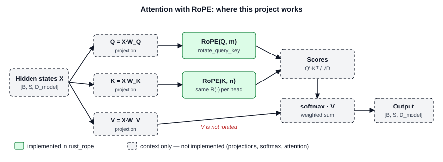

> **Project scope.** `rust_rope` implements RoPE itself: frequencies,
> positions, rotations, the application to query and key tensors, layouts,
> partial rotation and scaling. It does **not** implement projections,
> softmax, attention, masking, a KV cache or any GPU code.

## Chapter 2: Mathematical Prerequisites

This chapter teaches the mathematics that RoPE needs. For every concept we
give the definition, the reason, the equation, a numerical example, the
geometric meaning and the place in the Rust code.

### 2.1 Vectors and dimensions

**Definition.** A **vector** is an ordered list of numbers:
`v = [v₁, v₂, …, vₙ]`. The number of components `n` is the **dimension**.

**Why it matters.** Every token is a vector. RoPE transforms vectors.

**Geometric meaning.** A 2-D vector `[x, y]` is an arrow from the origin
`(0, 0)` to the point `(x, y)`. Addition places arrows end to end.

**Example.** `[1, 2, 3] + [4, 5, 6] = [5, 7, 9]`. Addition needs equal
dimensions: `[1, 2, 3] + [1, 2]` is not defined.

> **Project file:** `src/math/matrix.rs` · **Type:** `Vector` (a `Vec<f64>`
> with checked operations `checked_add`, `checked_sub`, `dot`,
> `magnitude`) and `Vector2 = [f64; 2]`. Operations on different
> dimensions return the error `DimensionMismatch`.

### 2.2 The dot product

**Definition.**

```math
a · b = a₁b₁ + a₂b₂ + … + aₙbₙ = Σᵢ aᵢbᵢ
```

**Geometric meaning.** `a · b = ‖a‖·‖b‖·cos(α)`, where `α` is the angle
between the arrows. Thus the dot product measures similarity of direction:

- `a · b > 0`: similar directions.
- `a · b = 0`: perpendicular.
- `a · b < 0`: opposite directions.

**Derivation in 2-D.** Write `a = r·[cos φ, sin φ]` and
`b = s·[cos ψ, sin ψ]`. Then
`a · b = r·s·(cos φ cos ψ + sin φ sin ψ) = r·s·cos(ψ − φ)`
(the angle-difference identity of section 2.6).

**Example.** `[1, 2, 3] · [4, 5, 6] = 4 + 10 + 18 = 32`.

**Why it matters.** The attention score is a dot product (Chapter 1).

### 2.3 The Euclidean norm

**Definition.** The **norm** (length, magnitude) of `v`:

```math
‖v‖ = √(v₁² + v₂² + … + vₙ²) = √(v · v)
```

This is the theorem of Pythagoras, applied `n − 1` times.
**Example:** `‖[3, 4]‖ = √(9 + 16) = 5`.

**Why it matters.** RoPE keeps the norm of every pair (Chapter 6). This is
the property "RoPE changes directions, not lengths".

### 2.4 Angles: degrees and radians

An angle measures a rotation. A full turn is 360 degrees. The **radian**
is the natural unit: the angle `θ` in radians is the arc length on a circle
divided by its radius, `θ = s / r`. A full turn is `2π ≈ 6.2832` radians.

```math
θ_radians = θ_degrees · π / 180        θ_degrees = θ_radians · 180 / π
```

**Example:** 90° = `π/2 ≈ 1.5708` rad; `1 rad ≈ 57.3°`.

**Why radians.** The derivative of `sin θ` is `cos θ` only in radians, and
`sin θ ≈ θ` for small `θ` only in radians. RoPE angles are always radians.

> **Project file:** `src/math/trigonometry.rs` · **Functions:**
> `degrees_to_radians`, `radians_to_degrees`.

### 2.5 The unit circle, sine and cosine

The **unit circle** is the circle with radius 1 around the origin. The
point at angle `θ` (measured counter-clockwise from the positive x-axis)
has the coordinates:

```math
x = cos θ        y = sin θ
```

This is the definition of cosine and sine. The figure below shows it.

. The red segment is cos θ, the green segment is sin θ. See section 2.5.")

Table: Sine and cosine at the four quarter turns

| `θ` | 0 | `π/2` | `π` | `3π/2` |
|---|---|---|---|---|
| `(cos θ, sin θ)` | (1, 0) | (0, 1) | (−1, 0) | (0, −1) |

**Identities used in this guide:**

```math
sin²θ + cos²θ = 1                                (Pythagoras on the unit circle)
cos(−θ) = cos θ,       sin(−θ) = −sin θ          (symmetry)
sin(θ + 2πk) = sin θ,  cos(θ + 2πk) = cos θ      (period 2π)
cos(α + β) = cos α cos β − sin α sin β           (angle addition)
sin(α + β) = sin α cos β + cos α sin β
```

> **Project file:** `src/math/trigonometry.rs` · **Functions:** `sine`,
> `cosine`, `sin_cos` (both values from one call), `unit_circle_point`.

Listing: `src/math/trigonometry.rs` — `sin_cos`

```rust
pub fn sin_cos(theta: f64) -> (f64, f64) {
    theta.sin_cos()
}
```

The function returns a **tuple** `(sin θ, cos θ)`. A rotation always needs
both values, so one call is convenient. The function is a thin wrapper: the
standard library does the calculation.

### 2.6 Matrices and matrix multiplication

A **matrix** is a rectangular table of numbers. A 2 × 2 matrix has two rows
and two columns. Matrix-vector multiplication:

```math
[ a  b ] [ x ]   [ a·x + b·y ]
[ c  d ] [ y ] = [ c·x + d·y ]
```

Each output component is the dot product of one row with the vector.
Matrix-matrix multiplication combines two transformations: `(M·N)·v`
means "first `N`, then `M`". In general `M·N ≠ N·M`.

**Example:** `[[1, 2], [3, 4]]·[5, 6] = [1·5 + 2·6, 3·5 + 4·6] = [17, 39]`.

> **Project file:** `src/math/matrix.rs` · **Type:** `Matrix2` (stored
> row by row as `[[f64; 2]; 2]`, 32 bytes, `Copy`) with `mul_vector`,
> `mul_matrix`, `transpose`, `determinant`, `rotation`.

### 2.7 Rotation matrices

The matrix that rotates every vector by the angle `θ` around the origin:

```math
R(θ) = [ cos θ   −sin θ ]
       [ sin θ    cos θ ]
```

**Derivation 1 (axis vectors).** The columns of a matrix are the images of
`[1, 0]` and `[0, 1]`. A rotation by `θ` moves `[1, 0]` to the unit-circle
point `[cos θ, sin θ]`: the first column. It moves `[0, 1]` (angle `π/2`)
to `[cos(θ + π/2), sin(θ + π/2)] = [−sin θ, cos θ]`: the second column.

**Derivation 2 (polar coordinates).** Write `v = r·[cos α, sin α]`. The
rotated vector is `r·[cos(α + θ), sin(α + θ)]`. Expand with the
angle-addition formulas:

```math
x' = r(cos α cos θ − sin α sin θ) = x cos θ − y sin θ
y' = r(sin α cos θ + cos α sin θ) = x sin θ + y cos θ
```

This is exactly `R(θ)·[x, y]`.

### 2.8 Orthogonal transformations

A matrix `Q` is **orthogonal** if `QᵀQ = I`. (`Qᵀ`, the **transpose**,
swaps rows and columns; `I` is the identity matrix.) Rotation matrices are
orthogonal:

```math
R(θ)ᵀ = [  cos θ   sin θ ] = R(−θ)          R(θ)ᵀ·R(θ) = R(−θ)·R(θ) = R(0) = I
        [ −sin θ   cos θ ]
```

**Properties used by RoPE:**

```math
R(α)·R(β) = R(α + β)            (composition: angles add)
R(θ)ᵀ = R(−θ) = R(θ)⁻¹          (the transpose undoes the rotation)
R(α)ᵀ·R(β) = R(β − α)           (the relative-rotation identity)
det R(θ) = cos²θ + sin²θ = 1    (no reflection, no change of area)
```

Orthogonal transformations keep lengths and dot products:
`(Qa)·(Qb) = aᵀQᵀQb = a·b`. Chapter 10 uses exactly this algebra.

Listing: `src/math/matrix.rs` — `Matrix2::rotation`, `rotate_vector`

```rust
    pub fn rotation(theta: f64) -> Matrix2 {
        let (sin, cos) = sin_cos(theta);
        Matrix2::new(cos, -sin, sin, cos)
    }
```

```rust
pub fn rotate_vector(v: Vector2, theta: f64) -> Vector2 {
    Matrix2::rotation(theta).mul_vector(v)
}
```

`rotate_vector` is the single place in the library where a rotation is
calculated. Chapter 6 shows that RoPE's pair rotation calls it.

 rotated by θ = 0.9 rad. Both arrows lie on the same dashed circle: the length √10 does not change. See sections 2.7 and 4.1.")

## Chapter 3: Complex Numbers and Rotations

### 3.1 Complex numbers

A **complex number** is `z = a + bi`. `a` is the **real** component,
`Re(z)`. `b` is the **imaginary** component, `Im(z)`. `i` is the
**imaginary unit**, defined by `i² = −1`. Geometrically, `z` is the point
`(a, b)` in the **complex plane** (real axis horizontal, imaginary axis
vertical). Two real numbers describe it completely.

> **Notation.** Because `i` is the imaginary unit, this project uses `j`
> for the pair index of RoPE (Chapter 5). Many papers write `i` for both.

> **Project file:** `src/math/complex.rs` · **Type:** `Complex { re: f64, im: f64 }`
> (16 bytes, `Copy`).

### 3.2 Operations

Table: Complex number operations

| Operation | Formula | Example (`z = 1 + 2i`, `w = 3 + 4i`) |
|---|---|---|
| Addition | `(a + bi) + (c + di) = (a + c) + (b + d)i` | `4 + 6i` |
| Multiplication | `(a + bi)(c + di) = (ac − bd) + (ad + bc)i` | `−5 + 10i` |
| Conjugate | `conj(a + bi) = a − bi` | `conj(w) = 3 − 4i` |
| Magnitude | `|z| = √(a² + b²)` | `|w| = 5` |
| Phase | `arg(z) = atan2(b, a)` | `arg(−1 − i) = −3π/4` |

**Derivation of the multiplication.** Expand the product and use `i² = −1`:
`(a + bi)(c + di) = ac + adi + bci + bd·i² = (ac − bd) + (ad + bc)i`.

**The phase** is the angle of the point. We use `atan2(b, a)`, not
`atan(b/a)`: `atan(b/a)` cannot separate `1 + i` from `−1 − i`, and it is
undefined for `a = 0`.

Listing: `src/math/complex.rs` — `Mul::mul`

```rust
    fn mul(self, other: Complex) -> Complex {
        let (a, b) = (self.re, self.im);
        let (c, d) = (other.re, other.im);
        Complex::new(a * c - b * d, a * d + b * c)
    }
```

The `impl Mul for Complex` block lets us write `z * w`. Rust calls this
method for the `*` operator.

### 3.3 Euler's formula

```math
e^(iθ) = cos θ + i·sin θ
```

**Derivation.** The exponential function has the power series
`e^x = 1 + x + x²/2! + x³/3! + …` (`n! = 1·2·…·n`). Put `x = iθ`. The
powers of `i` repeat: `1, i, −1, −i, 1, …`. Collect the terms:

```math
e^(iθ) = (1 − θ²/2! + θ⁴/4! − …) + i·(θ − θ³/3! + θ⁵/5! − …) = cos θ + i·sin θ
```

The two brackets are the power series of `cos θ` and `sin θ`.

**Geometric meaning.** `e^(iθ)` is the unit-circle point at angle `θ`. Its
magnitude is 1. At `θ = π`: `e^(iπ) = −1` (Euler's identity).
**Polar form:** every `z` is `r·e^(iφ)` with `r = |z|` and `φ = arg(z)`.

### 3.4 Why multiplication by e^(iθ) rotates

```math
z·e^(iθ) = r·e^(iφ)·e^(iθ) = r·e^(i(φ + θ))
```

The magnitude stays `r`. The phase increases by `θ`. This is a rotation by
`θ` around the origin. In components, with `z = x + iy`:

```math
(x + iy)(cos θ + i sin θ) = (x cos θ − y sin θ) + i·(x sin θ + y cos θ)
```

The real part is `x'` and the imaginary part is `y'` of `R(θ)·[x, y]`.
**The complex rotation and the matrix rotation are the same operation.**

: same magnitude √5, phase increased by 1 rad. The result equals pair 0 of the worked example in Chapter 6. See section 3.4.")

**The conjugate reverses a rotation:** `conj(e^(iθ)) = e^(−iθ)`. And
`Re[u·conj(w)]` equals the 2-D dot product of `u` and `w`. Chapter 10 uses
both facts.

Listing: `src/math/complex.rs` — `Complex::from_polar`, `Complex::rotate`

```rust
    pub fn from_polar(r: f64, phi: f64) -> Self {
        let (sin, cos) = sin_cos(phi);
        Self::new(r * cos, r * sin)
    }
```

```rust
    pub fn rotate(self, theta: f64) -> Self {
        self * Self::from_polar(1.0, theta)
    }
```

`rotate` reuses the multiplication: `self * e^(iθ)`. The integration test
`complex_rotation_equals_matrix_rotation` in `tests/numerical_tests.rs`
checks that `Complex::rotate` and `rotate_vector` agree for 9 angles and 6
vectors. The test `rope_equals_complex_multiplication_per_pair` checks that
the RoPE output equals the complex form **bit for bit**: both forms perform
the same floating-point operations in the same order.

### 3.5 Floating-point limits in this chapter

The `f64` constant `PI` is not exactly `π` (it is `π − 1.22 × 10⁻¹⁶`).
Thus `sin(PI) = 1.2246 × 10⁻¹⁶`, not 0, and `e^(iπ)` in `f64` is
`−1 + 1.2246 × 10⁻¹⁶i`. The function is correct; the input is not exactly
`π`. Chapter 21 explains this in detail. Tests therefore compare with a
tolerance (`approx_eq` in `src/math/mod.rs`).

# Part II — Understanding RoPE

## Chapter 4: The Mathematics of RoPE

### 4.1 One pair: a two-dimensional vector

Start with the smallest case, a vector with two components:
`x = [x₀, x₁]`. RoPE rotates it by an angle `θ` with the rotation matrix of
section 2.7:

```math
x' = R(θ)·x = [ cos θ   −sin θ ] [ x₀ ]
              [ sin θ    cos θ ] [ x₁ ]
```

Multiply row by row (section 2.6):

```math
x'₀ = x₀·cos θ − x₁·sin θ
x'₁ = x₀·sin θ + x₁·cos θ
```

**What each term does.** The first output takes most of `x₀` (factor
`cos θ`) and mixes in `x₁` with a negative weight. The second output takes
most of `x₁` and mixes in `x₀`. For `θ = 0`, `cos θ = 1` and `sin θ = 0`,
so `x' = x`.

**Why the length stays the same.** Square and add:

```math
x'₀² + x'₁² = x₀²cos²θ − 2x₀x₁ sin θ cos θ + x₁²sin²θ
            + x₀²sin²θ + 2x₀x₁ sin θ cos θ + x₁²cos²θ
            = x₀²(cos²θ + sin²θ) + x₁²(sin²θ + cos²θ) = x₀² + x₁²
```

The cross terms cancel, and `sin² + cos² = 1`.

### 4.2 From one pair to a d-dimensional embedding

A real embedding has `d` components (for example 64 or 128). RoPE divides
it into `d/2` **pairs** and rotates each pair in its own plane, with its own
angle:

```math
x = [x₀, x₁ | x₂, x₃ | … | x_(d−2), x_(d−1)]
pair j = (x₂ⱼ, x₂ⱼ₊₁),    j = 0, 1, …, d/2 − 1
angle of pair j at position m:  φ(m, j) = m · θⱼ
```

**Why pairs?** A rotation in a plane has exactly one parameter, the angle.
Thus one pair can carry one piece of position information. `d/2`
independent planes carry `d/2` different angles. Rotations in the same
plane commute (`R(a)R(b) = R(b)R(a) = R(a + b)`), which keeps the
mathematics simple. (Rotations in 3-D do not commute.)

As one matrix, RoPE at position `m` is **block-diagonal**: 2 × 2 rotation
blocks on the diagonal, zeros elsewhere:

```math
R_m = diag( R(m·θ₀), R(m·θ₁), …, R(m·θ_(d/2−1)) )        RoPE(x, m) = R_m · x
```

The implementation never builds this `d × d` matrix: it would have `d²`
elements, almost all zero. A loop over the pairs does the same work with
`d/2` small rotations.

**Complex view.** Pair `j` is the complex number `zⱼ = x₂ⱼ + i·x₂ⱼ₊₁`.
RoPE multiplies it by `e^(i·m·θⱼ)` (section 3.4). Thus a `d`-dimensional
real vector is a `d/2`-dimensional complex vector, and RoPE multiplies each
component by its own unit complex number. The RoFormer paper derives RoPE
in this form.

## Chapter 5: RoPE Frequencies

### 5.1 The variables

```math
θⱼ = 1 / b^(2j/d) = b^(−2j/d)          φ(m, j) = m · θⱼ
```

Table: Symbols of the frequency formula

| Symbol | Name | Meaning | Example |
|---|---|---|---|
| `j` | pair index | selects the pair `(x₂ⱼ, x₂ⱼ₊₁)`, `0 ≤ j < d/2` | 0, 1, 2, 3 |
| `m` | token position | the index of the token in the sequence, 0, 1, 2, … | 4096 |
| `d` | rotary dimension | number of rotated components, even | 8, 64, 128 |
| `b` | frequency base | sets the slowest speed | 10 000 |
| `θⱼ` | inverse frequency | rotation speed of pair `j` in radians per position | 1, 0.1, 0.01, 0.001 |
| `φ(m, j)` | angle | total rotation of pair `j` at position `m` | `m·θⱼ` |

(The task statements write `frequency(i)` and `angle(m, i)`; `i` there is
our `j`.)

### 5.2 Why different pairs need different frequencies

If all pairs used `θ = 1`, the angle at position `m` would be `m` radians.
A rotation by `2π` is no rotation, so the position information **wraps
around**: `44 mod 2π ≈ 0.018`, thus position 44 looks almost like position
0. If all pairs used a very slow speed, neighbouring positions would have
almost the same angle.

A clock solves this with several hands: the second hand separates
neighbouring seconds but repeats every minute; the hour hand never repeats
in a day but cannot show seconds. RoPE uses `d/2` hands, from fast
(`θ₀ = 1`) to slow (`θ_(d/2−1) ≈ 1/b`). **High-frequency** pairs encode
small distances precisely. **Low-frequency** pairs encode large distances
without wrapping around.

### 5.3 Why the exponent is 2j/d

- **`2j` is the index of the first dimension of pair `j`.** The exponent is
  "dimension index / dimension", the same as the sinusoidal encoding
  (section 1.4).
- **`2j/d = j/(d/2)`:** the fraction of the pairs before pair `j`. It goes
  from 0 to `(d − 2)/d < 1`.
- **The division by `d` normalizes the exponent to `[0, 1)`.** Then the
  speeds always cover the range `(1/b, 1]`, for every `d`. Without the
  division, `d = 128` would give `θ₆₃ = 10000^(−126) = 10^(−504)`, which is
  exactly `0` in `f64`.
- **With `j/d` instead**, the exponent would stop at about 0.5, and the
  slowest speed would be `1/√b = 0.01` instead of almost `1/b`.

**Why `θⱼ` decreases.** `b^x = e^(x·ln b)` and `ln b > 0` for `b > 1`. Thus
`b^x` grows with `x`, and its inverse `θⱼ` falls with `j`. This is why
`rust_rope` requires `b > 1` (`validate_base`): `b = 1` gives equal speeds,
and `b < 1` reverses the order.

**Why 10 000?** It is the value of the original Transformer and the RoFormer
paper. It makes the longest wavelength about `2π·10 000 ≈ 62 832`
positions, longer than the training contexts of early models. Newer models
use larger bases (for example 500 000 in LLaMA 3) for longer contexts.

### 5.4 A geometric sequence

```math
θ_(j+1) / θⱼ = b^(−2(j+1)/d) / b^(−2j/d) = b^(−2/d)        (constant)
ln θⱼ = −(2j/d)·ln b                                        (linear in j)
λⱼ = 2π / θⱼ = 2π·b^(2j/d)                                  (wavelength)
```

The speeds are evenly spaced on a logarithmic scale. `λⱼ` is the number of
positions that pair `j` needs for one full turn. The figure below shows the
distribution.

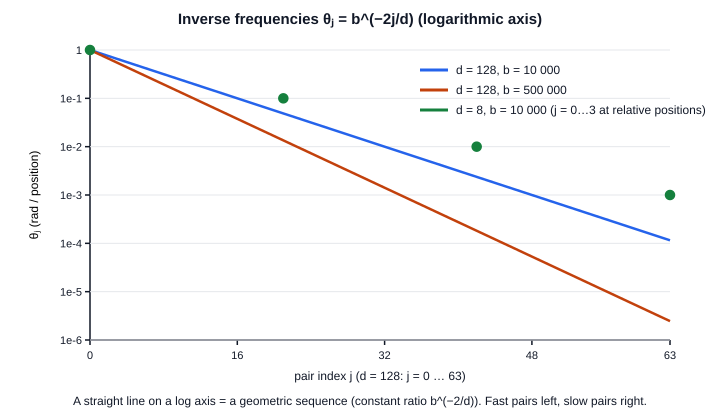

### 5.5 Complete numerical example: d = 8, b = 10 000

`d = 8` gives 4 pairs, `j = 0, 1, 2, 3`. Write `b = 10000 = 10⁴`, so
`b^x = 10^(4x)`.

```math
j = 0:  exponent 2·0/8 = 0      b^0    = 1                  θ₀ = 1/1    = 1
j = 1:  exponent 2·1/8 = 0.25   b^0.25 = 10^(4·0.25) = 10   θ₁ = 1/10   = 0.1
j = 2:  exponent 2·2/8 = 0.5    b^0.5  = 10^2       = 100   θ₂ = 1/100  = 0.01
j = 3:  exponent 2·3/8 = 0.75   b^0.75 = 10^3       = 1000  θ₃ = 1/1000 = 0.001
```

The ratio is `10000^(−2/8) = 0.1`: each pair is 10 times slower than the
previous pair. The wavelengths are 6.28, 62.83, 628.32 and 6283.19
positions.

**Angles at positions 0 to 4.** Each cell is `m·θⱼ`:

```math
m = 0:  0·1 = 0   0·0.1 = 0     0·0.01 = 0     0·0.001 = 0
m = 1:  1·1 = 1   1·0.1 = 0.1   1·0.01 = 0.01  1·0.001 = 0.001
m = 2:  2·1 = 2   2·0.1 = 0.2   2·0.01 = 0.02  2·0.001 = 0.002
m = 3:  3·1 = 3   3·0.1 = 0.3   3·0.01 = 0.03  3·0.001 = 0.003
m = 4:  4·1 = 4   4·0.1 = 0.4   4·0.01 = 0.04  4·0.001 = 0.004
```

Table: Angle table φ(m, j) for d = 8, b = 10 000 (radians)

| `m` | `j = 0` | `j = 1` | `j = 2` | `j = 3` |
|---|---|---|---|---|
| 0 | 0 | 0 | 0 | 0 |
| 1 | 1 | 0.1 | 0.01 | 0.001 |
| 2 | 2 | 0.2 | 0.02 | 0.002 |
| 3 | 3 | 0.3 | 0.03 | 0.003 |
| 4 | 4 | 0.4 | 0.04 | 0.004 |

- **Position 0** gives the angle 0 for every pair, so `R = I`: the first
  token is not changed.
- **One column** (fixed `j`) grows linearly with step `θⱼ`.
- **One row** (fixed `m ≥ 1`) falls by the factor 10 from pair to pair, so
  all angles of one token are different.
- In `f64`, `3·0.1` prints as `0.30000000000000004`, because `0.1` has no
  exact binary representation (Chapter 21).

### 5.6 The Rust implementation of frequencies and positions

Listing: `src/rope/frequencies.rs` — `inverse_frequency_unchecked`, `inverse_frequencies`

```rust
pub(crate) fn inverse_frequency_unchecked(pair_index: usize, dimension: usize, base: f64) -> f64 {
    let exponent = (2 * pair_index) as f64 / dimension as f64;
    base.powf(-exponent)
}
```

```rust
pub fn inverse_frequencies(config: &RopeConfig) -> Vec<f64> {
    let dimension = config.dimension();
    let base = config.base();
    (0..config.num_pairs())
        .map(|j| inverse_frequency_unchecked(j, dimension, base))
        .collect()
}
```

**How the code implements the equation.**

- `(2 * pair_index) as f64 / dimension as f64` is `2j/d`. The `as f64`
  conversions happen **before** the division; otherwise Rust would do an
  integer division (`2/8 = 0`).
- `base.powf(-exponent)` is `b^(−2j/d)` with one rounding. The form
  `1.0 / base.powf(x)` would round twice.
- `(0..n).map(...).collect()` builds the `Vec<f64>`. A range knows its exact
  length, so `collect` allocates the final capacity once.
- The function takes `&RopeConfig`: it **borrows** the configuration and
  only reads it. It cannot fail, because every `RopeConfig` is valid
  (Chapter 19).
- `pub(crate)` makes the unchecked helper visible inside the crate but not
  to users of the library.

Listing: `src/rope/frequencies.rs` — `angle_unchecked`

```rust
pub(crate) fn angle_unchecked(position: Position, inverse_frequency: f64) -> f64 {
    position.as_f64() * inverse_frequency
}
```

The angle is one multiplication. `Position` is a **newtype** around
`usize`: a struct with one field. It prevents a mix-up of the token position
`m` with the pair index `j` (both are integers), and it guarantees
`m ≤ 2^53`, so `as_f64` is exact (Chapter 21). The public function `angle`
validates its frequency first; `AngleTable` stores a whole `L × d/2` table
in one row-major `Vec<f64>`.

Listing: `src/rope/position.rs` — `PositionRange::iter`

```rust
    pub fn iter(self) -> impl Iterator<Item = Position> {
        (self.start..self.start + self.length).map(Position)
    }
```

`PositionRange` stores only `start` and `length` (16 bytes) and creates the
positions `start, start + 1, …` **lazily**: no list is allocated. The
return type `impl Iterator<Item = Position>` means "some iterator type that
produces `Position` values". `map(Position)` uses the tuple-struct
constructor as a function.

> **Tests:** `worked_example_d8_b10000`, `inverse_frequencies_decrease_strictly`,
> `inverse_frequencies_form_a_geometric_sequence`,
> `position_zero_gives_zero_angles`, `angles_increase_linearly_with_position`,
> `different_pairs_give_different_angles_at_nonzero_positions`
> (all in `tests/numerical_tests.rs`).

## Chapter 6: Applying RoPE to Embeddings

### 6.1 The transformation

For the interleaved layout (Chapter 7), at token position `m`:

```math
φⱼ = m · θⱼ
x'[2j]   = x[2j]·cos φⱼ − x[2j+1]·sin φⱼ
x'[2j+1] = x[2j]·sin φⱼ + x[2j+1]·cos φⱼ
```

### 6.2 Complete numerical example: d = 8, b = 10 000, m = 1

1. **Original vector:** `x = [1, 2, 3, 4, 5, 6, 7, 8]`.
2. **Inverse frequencies** (Chapter 5): `θ = [1, 0.1, 0.01, 0.001]`.
3. **Token position:** `m = 1`.
4. **Angles:** `φ = 1·θ = [1, 0.1, 0.01, 0.001]`.
5. **Sine and cosine** (7 decimals):

Table: Sine and cosine values of the worked example

| pair | `φ` | `cos φ` | `sin φ` |
|---|---|---|---|
| 0 | 1 | 0.5403023 | 0.8414710 |
| 1 | 0.1 | 0.9950042 | 0.0998334 |
| 2 | 0.01 | 0.9999500 | 0.0099998 |
| 3 | 0.001 | 0.9999995 | 0.0010000 |

6. **Each pairwise rotation:**

```math
pair 0 (1, 2):  x'0 = 1·0.5403023 − 2·0.8414710 = 0.5403023 − 1.6829420 = −1.1426397
                x'1 = 1·0.8414710 + 2·0.5403023 = 0.8414710 + 1.0806046 =  1.9220756
pair 1 (3, 4):  x'2 = 3·0.9950042 − 4·0.0998334 = 2.9850125 − 0.3993337 =  2.5856788
                x'3 = 3·0.0998334 + 4·0.9950042 = 0.2995002 + 3.9800167 =  4.2795169
pair 2 (5, 6):  x'4 = 5·0.9999500 − 6·0.0099998 = 4.9997500 − 0.0599990 =  4.9397510
                x'5 = 5·0.0099998 + 6·0.9999500 = 0.0499992 + 5.9997000 =  6.0496992
pair 3 (7, 8):  x'6 = 7·0.9999995 − 8·0.0010000 = 6.9999965 − 0.0080000 =  6.9919965
                x'7 = 7·0.0010000 + 8·0.9999995 = 0.0070000 + 7.9999960 =  8.0069960
```

7. **Final rotated vector:**

```math
x' = [−1.1426397, 1.9220756, 2.5856788, 4.2795169, 4.9397510, 6.0496992, 6.9919965, 8.0069960]
```

**Length check per pair:** `(−1.1426397)² + 1.9220756² ≈ 5 = 1² + 2²`,
`2.5856788² + 4.2795169² ≈ 25 = 3² + 4²`, and so on. The total squared
length is `5 + 25 + 61 + 113 = 204` before and after. Pair 0 (fast)
rotated by 57°; pair 3 (slow) rotated by only 0.06°.

The program `cargo run --example basic_rope` prints these values in full
`f64` precision, for example
`x' = [-1.1426396637476532, 1.922075596544176, 2.585678829246765, …]`.

### 6.3 Why rotation preserves the magnitude of each pair

Section 4.1 proved `x'₀² + x'₁² = x₀² + x₁²` for one pair. Every pair is
rotated independently, so every pair keeps its length, and the squared
length of the whole vector (the sum over the pairs) is also kept. In the
complex view: `|zⱼ·e^(iφ)| = |zⱼ|·1`. This is the key difference from
additive position encodings: RoPE changes **directions**, not **lengths**,
and adds no new vector.

### 6.4 The Rust implementation

Listing: `src/rope/rotations.rs` — `rotate_pair`

```rust
pub fn rotate_pair(pair: Vector2, phi: f64) -> Vector2 {
    rotate_vector(pair, phi)
}
```

`rotate_pair` gives the operation its RoPE name and calls the general
rotation of `src/math/matrix.rs`. Thus the rotation formula exists **once**
in the library. `Vector2` is `[f64; 2]`, a `Copy` type: the function
receives a copy of the pair on the stack and returns a new pair; nothing is
allocated.

Listing: `src/rope/embeddings.rs` — `RotaryEmbedding::rotate`

```rust
    pub fn rotate(&self, embedding: &[f64], position: Position) -> Result<Vec<f64>, RopeError> {
        validate_embedding_dimension(embedding.len(), self.dimension())?;
        let mut output = embedding.to_vec();
        self.rotate_pairs(&mut output, position);
        Ok(output)
    }
```

- `embedding: &[f64]` is a **borrowed slice**: the caller keeps the input.
- The length is validated **before** the allocation; an invalid input
  costs nothing.
- `to_vec()` is the one necessary copy: the caller keeps the input, so the
  output needs its own memory.
- `rotate_pairs` is the one rotation loop (section 7.4). `rotate_in_place`
  calls the same loop on the caller's `&mut [f64]` without any allocation.
- `Ok(output)` **moves** the `Vec` to the caller: only the 24-byte header
  moves; the heap data stays in place.

`RotaryEmbedding` is a struct that stores the configuration and the
inverse frequencies. It computes the `d/2` frequencies **one time** in
`RotaryEmbedding::new`; every rotation only reads them.

> **Tests:** `eight_dimensional_worked_example`, `position_zero_returns_an_exact_copy`,
> `rotate_and_rotate_in_place_agree` (`tests/rope_tests.rs`);
> `invariant_a_position_zero_is_the_identity`,
> `invariant_b_pair_magnitudes_are_preserved`,
> `invariant_c_embedding_rotations_compose`,
> `invariant_d_each_pair_gets_its_own_angle`,
> `invariant_e_large_positions_and_bases` (`tests/numerical_tests.rs`).

## Chapter 7: Interleaved and Split-Half Layouts

### 7.1 Two conventions for the pairs

Table: The two pair layouts for d = 6

| Layout | Pair `j` | `x = [x0, x1, x2, x3, x4, x5]` |
|---|---|---|
| Interleaved | `(x₂ⱼ, x₂ⱼ₊₁)` | `(x0, x1)`, `(x2, x3)`, `(x4, x5)` |
| Split-half | `(xⱼ, x_(j + d/2))` | `(x0, x3)`, `(x1, x4)`, `(x2, x5)` |

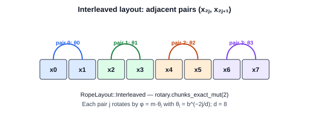

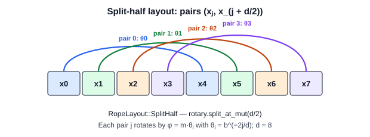

### 7.2 The split-half equation

```math
x'ⱼ         = xⱼ · cos φⱼ − x_(j + d/2) · sin φⱼ
x'_(j + d/2) = xⱼ · sin φⱼ + x_(j + d/2) · cos φⱼ
```

Step by step: take the "first" coordinate from the first half and the
"second" coordinate from the second half; treat them as a point in a plane;
apply `R(φⱼ)`. Many PyTorch implementations write the same operation
without pairs, with a helper `rotate_half([a, b]) = [−b, a]` (`a` = first
half, `b` = second half):

```math
x' = x ⊙ [cos φ, cos φ] + rotate_half(x) ⊙ [sin φ, sin φ]
```

(`⊙` is element-by-element multiplication.) For component `j < d/2` this
gives `xⱼ cos φⱼ − x_(j+d/2) sin φⱼ`: the first equation.

### 7.3 Why both layouts are pairwise rotations

Every component belongs to exactly one pair, and no two pairs share a
component. Thus both layouts are block rotations of disjoint planes; only
the **order of the coordinates** differs. With a permutation `P` that moves
`xⱼ` to slot `2j` and `x_(j+d/2)` to slot `2j + 1`:

```math
RoPE_split(x) = Pᵀ · RoPE_interleaved(P·x)
```

`P` is orthogonal, so all properties (lengths, relative positions) are the
same. But the two layouts give **different numbers** for the same input.

**Why conventions must match.** The weights `W_Q` and `W_K` of a trained
model produce features in a fixed order. A model trained with split-half
treats features `j` and `j + d/2` as partners. Interleaved RoPE would rotate
feature `j` with feature `j + 1`: a different function. The scores would be
wrong, although every RoPE property still holds. The original LLaMA code
uses the complex (interleaved) view; the Hugging Face Llama implementation
uses `rotate_half` (split-half), and its weight conversion permutes the rows
of `W_Q` and `W_K` for exactly this reason. Both layouts use the same
frequencies `θⱼ = b^(−2j/d)`.

**Numerical example (split-half, `d = 6`, `m = 1`, `x = [1, 2, 3, 4, 5, 6]`).**
`θ = [1, 10000^(−1/3), 10000^(−2/3)] = [1, 0.0464159, 0.0021544]`.
Pairs `(1, 4)`, `(2, 5)`, `(3, 6)`. Pair 0:
`x'0 = 1·0.5403023 − 4·0.8414710 = −2.8255816` and
`x'3 = 1·0.8414710 + 4·0.5403023 = 3.0026802`. The full result is
`[−2.8255816, 1.7658498, 2.9870664, 3.0026802, 5.0874133, 6.0064494]`
(test `split_half_numerical_example`).

### 7.4 The Rust enum and the matching logic

Listing: `src/rope/config.rs` — `RopeLayout`

```rust
pub enum RopeLayout {
    #[default]
    Interleaved,
    SplitHalf,
}
```

An **enum** value is exactly one of its variants. These variants carry no
data, so the compiler stores the value as a small integer (the
**discriminant**). A string such as `"split_half"` could contain a typing
mistake that fails only at run time; with an enum, a wrong name does not
compile, and every `match` must handle every variant.

Listing: `src/rope/embeddings.rs` — `RotaryEmbedding::rotate_pairs`

```rust
        let (rotary, _pass_through) = embedding.split_at_mut(rotary_dimension);
        let factor = self.attention_factor;

        match self.config.layout() {
            RopeLayout::Interleaved => {
                for (pair, &theta) in rotary.chunks_exact_mut(2).zip(&self.inverse_frequencies) {
                    let phi = angle_unchecked(position, theta); // φ = m·θⱼ
                    let [ra, rb] = rotate_pair([pair[0], pair[1]], phi); // R(φ)·(x₂ⱼ, x₂ⱼ₊₁)
                    pair[0] = ra * factor;
                    pair[1] = rb * factor;
                }
            }
            RopeLayout::SplitHalf => {
                let (first, second) = rotary.split_at_mut(rotary_dimension / 2);
                for ((a, b), &theta) in first
                    .iter_mut()
                    .zip(second.iter_mut())
                    .zip(&self.inverse_frequencies)
                {
                    let phi = angle_unchecked(position, theta); // φ = m·θⱼ
                    let [ra, rb] = rotate_pair([*a, *b], phi); // R(φ)·(xⱼ, x_(j+d/2))
                    *a = ra * factor;
                    *b = rb * factor;
                }
            }
        }
```

(Comments of the source are shortened in this listing.)

- `chunks_exact_mut(2)` divides the slice into non-overlapping mutable
  sub-slices of exactly two values: the adjacent pairs.
- `zip` walks two iterators together: here the pairs and the frequencies.
  The pattern `(pair, &theta)` copies each `f64` out of its reference.
- `split_at_mut(k)` returns **two** mutable slices `[0, k)` and `[k, len)`.
  The borrow checker normally forbids two `&mut` borrows of one slice, but
  the standard library guarantees that these two do not overlap.
- `iter_mut()` gives `&mut f64` items; `*a = …` writes through the
  reference.
- `factor` is 1.0 for every method except YaRN (Chapter 14). IEEE 754
  guarantees `x · 1.0 = x` exactly, so standard RoPE is unchanged.

> **Tests:** `interleaved_layout_pairs_adjacent_components`,
> `split_half_layout_pairs_component_j_with_j_plus_half`,
> `both_layouts_keep_each_pair_length`,
> `layouts_are_equivalent_after_a_permutation` (`tests/rope_tests.rs`);
> `split_half_pairs_get_the_correct_angles`,
> `both_layouts_use_the_same_frequencies` (`tests/numerical_tests.rs`).

## Chapter 8: Partial RoPE

### 8.1 Why rotate only a part of the head

Some models (for example GPT-NeoX, GPT-J and Phi models) rotate only a
fraction of each attention head. The remaining components carry
**position-independent** content: their contribution to the score is the
same at every distance.

Example: head dimension `D = 128`, rotary dimension `d = 64`. The first 64
components rotate; the components 64 to 127 are copied unchanged.

```math
x' = [ RoPE(x[0..d], m),  x[d..D] ]        θⱼ = b^(−2j/d)   (d, not D)
score = q_rotᵀ · R(n − m) · k_rot  +  q_passᵀ · k_pass
```

The first term depends on the distance; the second term depends on no
position. As a matrix: `diag(R_m^(d), I_(D−d))`.

; the last 8 are never touched. See Chapter 8.")

### 8.2 The rules

- **`d` positive and even:** RoPE rotates pairs. `d = 0` is not RoPE; an
  odd `d` leaves one component without a partner.
- **`d ≤ D`:** RoPE can rotate only components that exist.
- **`D` may be odd** when `d < D`: the pass-through part needs no pairs.
- **Frequencies use `d`:** with `D = 128`, `d = 64`:
  `θ₁ = 10000^(−2/64) = 0.7499` (not `10000^(−2/128) = 0.8660`). The 32
  pairs still cover the full speed range.

### 8.3 The Rust implementation

Listing: `src/rope/config.rs` — `RopeConfig::with_head_dimension`

```rust
    pub fn with_head_dimension(self, head_dimension: usize) -> Result<Self, RopeError> {
        validate_head_dimension(head_dimension, self.dimension)?;
        Ok(RopeConfig {
            head_dimension,
            ..self
        })
    }
```

The method takes `self` **by value** (`RopeConfig` is `Copy`, so the
caller's value stays usable) and returns a new configuration. `..self`
copies all other fields (**struct update syntax**). A head dimension
smaller than the rotary dimension returns
`RopeError::RotaryDimensionTooLarge`.

In the rotation loop (section 7.4), `embedding.split_at_mut(rotary_dimension)`
separates the rotary part from the pass-through part. The code uses only the
first slice, so the pass-through values stay **bit-for-bit unchanged**
without any copy. Both layouts work on the rotary slice.

**Memory and computation.** Per head vector, partial RoPE needs `d/2`
instead of `D/2` `sin_cos` calls and writes `d` instead of `D` values. The
measured speed-up was smaller than this suggests (Chapter 30).

> **Tests:** `partial_rope_rotates_only_the_rotary_part`, `partial_rope_128_with_64`,
> `rotary_dimension_equal_to_head_dimension_is_full_rope`,
> `invalid_rotary_dimensions`, `tensors_with_layouts_and_partial_rope`
> (`tests/rope_tests.rs`).

# Part III — RoPE Inside Transformers

## Chapter 9: Query, Key and Value Integration

### 9.1 Hidden states and projections

A Transformer layer receives **hidden states** `X ∈ R^(B × S × D_model)`:

Table: The axes of the hidden-state tensor

| Symbol | Name | Meaning |
|---|---|---|
| `B` | batch size | number of independent sequences processed together |
| `S` | sequence length | number of tokens per sequence; token index `s = 0 … S − 1` |
| `D_model` | hidden dimension | length of the vector of one token |

`X[b, s, :]` is the hidden state of token `s` in sequence `b`. Sequences in
one batch never influence each other in attention.

The layer creates three vectors per token with learned matrices
`W_Q, W_K, W_V ∈ R^(D_model × D_model)`:

```math
Q = X·W_Q        K = X·W_K        V = X·W_V
```

- The **query** `q` asks "what does this token look for?"
- The **key** `k` answers "what does this token offer for comparison?" The
  score of query token `m` and key token `n` is `q_mᵀ k_n` (scaled by
  `1/√D` and normalized by softmax in a full model).
- The **value** `v` is "the information that this token gives". The output
  for token `m` is the weighted sum `Σₙ wₘₙ·v_n`.

The projection matrices are learned linear maps. **They are not
implemented in this project**: `rust_rope` starts after the projections.
The caller supplies `Q` and `K`.

### 9.2 Attention heads and the shape [B, S, H, D]

**Multi-head attention** runs `H` attention operations (heads) in
parallel, each on its own part of the projected vector:

```math
D_model = H · D        (D = head dimension)
```

Example: `D_model = 8`, `H = 2`, so `D = 4`. The projected query of one
token `[q₀, …, q₇]` divides into head 0 `[q₀, q₁, q₂, q₃]` and head 1
`[q₄, q₅, q₆, q₇]`. The **reshape** `[B, S, D_model] → [B, S, H, D]` only
reinterprets the indices: hidden index `c` becomes `(h, d)` with
`c = h·D + d`. The values stay in the same memory order, so the reshape
costs nothing.

For the example shape `[2, 4, 2, 4]`:

Table: The axes of the example tensor [2, 4, 2, 4]

| Axis | Index | Range | Meaning |
|---|---|---|---|
| 0 | `b` | 0 … 1 | which sequence of the batch |
| 1 | `s` | 0 … 3 | which token; its position is `m = start + s` |
| 2 | `h` | 0 … 1 | which attention head |
| 3 | `d` | 0 … 3 | which feature; RoPE pairs `(d₀, d₁)`, `(d₂, d₃)` |

The tensor has `2·4·2·4 = 64` values.

### 9.3 RoPE on queries and keys

For every batch element `b`, token `s` (position `m = start + s`) and head `h`:

```math
Q'[b, s, h, :] = R_m · Q[b, s, h, :]
K'[b, s, h, :] = R_m · K[b, s, h, :]
V' = V
```

**The same frequencies for all heads.** `θⱼ` depends only on `d` and `b`.
All heads use the same configuration, so all heads, all batch elements,
the queries and the keys use the **same** matrix `R_m` at position `m`.
`RotaryEmbedding` stores `θⱼ` once. What differs between heads is the
content of the vectors.

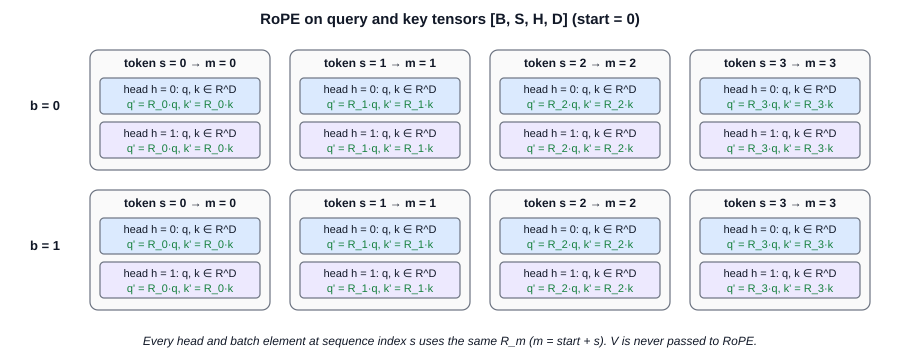

### 9.4 Why queries and keys, but not values

Attention uses vectors in two ways: **scores** compare a query with a key
(`q_mᵀk_n`), and **outputs** mix the values with weights from the scores.
Standard RoPE is designed to put position information into the scores, and
only there. If both `q_m` and `k_n` are rotated, the score depends on
`n − m` (Chapter 10). The values carry content; the weights already
contain the position information.

Rotating the values is mathematically possible, but it would be a
different design: the output of token `m` would mix vectors rotated by the
**absolute** positions of the other tokens. Standard RoPE (RoFormer, LLaMA
and most models) does not do this. The `rust_rope` API makes the design
explicit: the query/key methods have **no value parameter**.

### 9.5 The flat tensor and the index formula

`rust_rope` stores the tensor in one flat `Vec<f64>` in **row-major**
order: the last index changes fastest. The index of element
`(b, s, h, d)` (derived in Chapter 18) is:

```math
index = ((b·S + s)·H + h)·D + d
```

**Worked example** (`S = 4, H = 2, D = 4`), element `(1, 2, 1, 3)`:

```math
((1·4 + 2)·2 + 1)·4 + 3 = (6·2 + 1)·4 + 3 = 13·4 + 3 = 55
check: 1·(4·2·4) + 2·(2·4) + 1·4 + 3 = 32 + 16 + 4 + 3 = 55
```

Listing: `src/math/tensor.rs` — `Tensor4::index`

```rust
    pub fn index(&self, b: usize, s: usize, h: usize, d: usize) -> Option<usize> {
        let TensorShape {
            batch,
            sequence,
            heads,
            features,
        } = self.shape;
        if b < batch && s < sequence && h < heads && d < features {
            Some(((b * sequence + s) * heads + h) * features + d)
        } else {
            None
        }
    }
```

The **destructuring pattern** `let TensorShape { batch, … } = self.shape;`
copies the four fields into local variables. Each index is checked against
its own extent: checking only the final flat index is not sufficient
(`(0, 0, 0, 5)` with `D = 4` would give the valid index 5 of a different
element).

### 9.6 The tensor loop

Listing: `src/rope/embeddings.rs` — `RotaryEmbedding::rotate_tensor_unchecked`

```rust
    fn rotate_tensor_unchecked(&self, tensor: &mut Tensor4, positions: PositionRange) {
        let shape = tensor.shape();
        let token_len = shape.heads * shape.features; // H·D values per token
        let batch_len = shape.sequence * token_len; // S·H·D values per batch element
        debug_assert_eq!(positions.len(), shape.sequence);

        for batch_element in tensor.as_mut_slice().chunks_exact_mut(batch_len) {
            for (token, position) in batch_element
                .chunks_exact_mut(token_len)
                .zip(positions.iter())
            {
                for head in token.chunks_exact_mut(shape.features) {
                    self.rotate_pairs(head, position);
                }
            }
        }
    }
```

The three nested `chunks_exact_mut` calls follow the memory layout from
the outside to the inside: batch element (`S·H·D` values), token (`H·D`
values, zipped with its position), head (`D` values). There is **no index
arithmetic** in the loop, so batch, token and head boundaries cannot be
crossed by mistake, and the loop visits memory in increasing order. Every
head vector goes through the same `rotate_pairs` as a single vector.

The public methods are:

- `rotate_tensor_in_place(&mut tensor, start)`: one tensor, no allocation.
- `rotate_query_key_in_place(&mut q, &mut k, start)`: validates **both**
  tensors before it changes either (all or nothing), then rotates both.
  `B` and `S` must match; the head counts may differ (grouped-query
  attention).
- `rotate_query_key(&q, &k, start) -> (q', k')`: borrows the inputs and
  returns rotated copies (two clones).

> **Tests:** `tensor_shapes_batch_sequence_heads_and_head_dimensions`,
> `different_starting_positions`, `invalid_tensor_shapes`,
> `invalid_head_dimensions`, `value_tensor_is_preserved`, `batch_isolation`,
> `head_isolation`, `sequence_order_gives_increasing_positions`
> (`tests/rope_tests.rs`).

## Chapter 10: The Relative Position Property

### 10.1 The derivation

Let `Q'_m = R(m)·q` and `K'_n = R(n)·k`, where `R(m)` is the block-diagonal
`R_m` of Chapter 4. The attention score is the dot product
`(Q'_m)ᵀ K'_n`:

```math
(R(m)·q)ᵀ (R(n)·k)
  = qᵀ · R(m)ᵀ · R(n) · k        (1)  transpose of a product: (A·x)ᵀ = xᵀ·Aᵀ
  = qᵀ · R(−m) · R(n) · k        (2)  orthogonality: R(m)ᵀ = R(−m)
  = qᵀ · R(n − m) · k            (3)  composition: R(a)·R(b) = R(a + b)
```

**Step 1.** The transpose reverses the order of a product. A dot product
`uᵀw` with `u = R(m)q` becomes `qᵀR(m)ᵀw`.

**Step 2.** For each 2 × 2 block, `R(φ)ᵀ = R(−φ)`: transposing swaps the
signs of `sin φ`, and `sin(−φ) = −sin φ`. A block-diagonal matrix is
transposed block by block, so `R(m)ᵀ = diag(R(−m·θⱼ)) = R(−m)`.

**Step 3.** Block-diagonal matrices multiply block by block. Block `j`:
`R(−m·θⱼ)·R(n·θⱼ) = R((n − m)·θⱼ)`. Each pair composes **independently**
of the other pairs. Thus `R(−m)·R(n) = R(n − m)`.

**Why only `n − m` remains.** The middle matrix depends only on the
difference. `q` and `k` carry the content. The absolute positions vanish.
If every position is shifted by the same amount `s`, then
`(n + s) − (m + s) = n − m`, and no score changes.

**Per pair:** the score is a sum over pairs,
`Σⱼ (q-pair j)ᵀ · R((n − m)·θⱼ) · (k-pair j)`. Fast pairs react to small
distances; slow pairs to large distances.

**Complex form** (RoFormer). With `uⱼ` and `wⱼ` the complex numbers of pair
`j`, and `Re[u·conj(w)]` the 2-D dot product:

```math
Re[ uⱼ e^(imθⱼ) · conj(wⱼ e^(inθⱼ)) ] = Re[ uⱼ · conj(wⱼ) · e^(i(m − n)θⱼ) ]
```

### 10.2 Geometric explanation

The dot product of two 2-D vectors is `‖q‖·‖k‖·cos(α)`, where `α` is the
angle between them. RoPE rotates `q` by `mθ` and `k` by `nθ`. The angle
between the rotated vectors is `α + (n − m)θ`. Both lengths are unchanged.
Thus the score depends on the original angle `α` (content) and on
`(n − m)θ` (distance), never on `m` or `n` alone. Rotating both arrows by
the same extra angle does not change the angle between them.

### 10.3 Numerical demonstration in two dimensions

Choose `q = [1, 2]`, `k = [3, −1]`, frequency `θ = 0.5`, query position
`m = 2`, key position `n = 5`.

1. **Original query:** `q = [1, 2]`.
2. **Original key:** `k = [3, −1]`. (Without RoPE: `qᵀk = 3 − 2 = 1`.)
3. **Rotated query**, angle `m·θ = 1`:

```math
cos 1 = 0.5403023,  sin 1 = 0.8414710
q'₀ = 1·0.5403023 − 2·0.8414710 = −1.1426397
q'₁ = 1·0.8414710 + 2·0.5403023 =  1.9220756
```

4. **Rotated key**, angle `n·θ = 2.5`:

```math
cos 2.5 = −0.8011436,  sin 2.5 = 0.5984721
k'₀ = 3·(−0.8011436) − (−1)·0.5984721 = −2.4034308 + 0.5984721 = −1.8049587
k'₁ = 3·0.5984721 + (−1)·(−0.8011436) =  1.7954164 + 0.8011436 =  2.5965600
```

5. **Rotated dot product:**

```math
q'ᵀk' = (−1.1426397)·(−1.8049587) + 1.9220756·2.5965600 = 2.0624174 + 4.9907847 = 7.0532021
```

6. **Equivalent relative rotation**, angle `(n − m)·θ = 1.5`:

```math
cos 1.5 = 0.0707372,  sin 1.5 = 0.9974950
(R(1.5)k)₀ = 3·0.0707372 + 0.9974950 = 1.2097066
(R(1.5)k)₁ = 3·0.9974950 − 0.0707372 = 2.9217478
```

7. **Final dot product:**
   `qᵀR(1.5)k = 1·1.2097066 + 2·2.9217478 = 7.0532021`.

Both calculations give `7.053202107896084` in `f64`. The test
`two_dimensional_relative_position_demonstration` checks this within
`10⁻¹²`. The test `tensor_test_c_relative_position_property` checks
`(R(m)q)ᵀ(R(n)k) = qᵀR(n − m)k` for every batch element, head and pair of
positions of a `[2, 6, 2, 8]` tensor, and
`tensor_scores_do_not_depend_on_the_start_position` checks the shift
invariance.

> **Scope note.** These are tests of a mathematical property. `rust_rope`
> does not implement attention scores as a feature.

# Part IV — Long-Context Scaling

## Chapter 11: Why RoPE Scaling Is Needed

### 11.1 Original and target context

A model is trained with sequences of at most `L` tokens: the **original
context length** (for example 2048). We want to use it with `L' > L`
tokens: the **target context length**. Using positions `m ≥ L` without a
change is **extrapolation**.

### 11.2 Why longer positions cause problems

The mathematics of RoPE accepts any position. The **model** does not:
during training, pair `j` only saw the angles `m·θⱼ` for `0 ≤ m < L`.

Table: Trained and untrained angles for d = 8, b = 10 000, L = 2048

| Pair `j` | `θⱼ` | wavelength | largest trained angle `2047·θⱼ` | angle at `m = 8191` | new directions? |
|---|---|---|---|---|---|
| 0 | 1 | 6.28 | 2047 rad (326 turns) | 8191 rad | no |
| 1 | 0.1 | 62.8 | 204.7 rad (32.6 turns) | 819.1 rad | no |
| 2 | 0.01 | 628 | 20.47 rad (3.26 turns) | 81.91 rad | partly |
| 3 | 0.001 | 6283 | **2.047 rad (0.33 turn)** | **8.191 rad** | **yes** |

A **high-frequency** pair turned many times inside `L`; every direction on
its circle was seen. A **low-frequency** pair turned less than once; beyond
`L`, it points into directions that the model **never saw**, and the
attention scores become unreliable. Thus extending the context is not
"increase a configuration value": the angles of the slow pairs must stay in
the trained range.

**What `rust_rope` adds.** The module `src/rope/scaling.rs` changes the
inverse frequencies (and, for YaRN, one constant factor). The rotation loop
does not change. **Not implemented:** fine-tuning (the methods are normally
followed by a short fine-tuning of the model), dynamic NTK, LongRoPE.

## Chapter 12: Position Interpolation and Linear Scaling

### 12.1 Derivation

**Position interpolation** (Chen et al., 2023) compresses the positions
into the trained range:

```math
scale = L / L'                    (≤ 1)
m_scaled = m · scale
φ'(m, j) = m_scaled · θⱼ
```

The largest new position `L' − 1` maps to `(L' − 1)·L/L' = L − L/L' < L`.

**Example** (`L = 2048`, `L' = 8192`, `m = 4096`):

```math
scale    = 2048 / 8192 = 0.25
m_scaled = 4096 · 0.25 = 1024
angles without scaling (d = 8): 4096·θ = [4096, 409.6, 40.96, 4.096]
angles with scaling:            1024·θ = [1024, 102.4, 10.24, 1.024]
```

The last position 8191 maps to 2047.75, inside `[0, 2048)`.

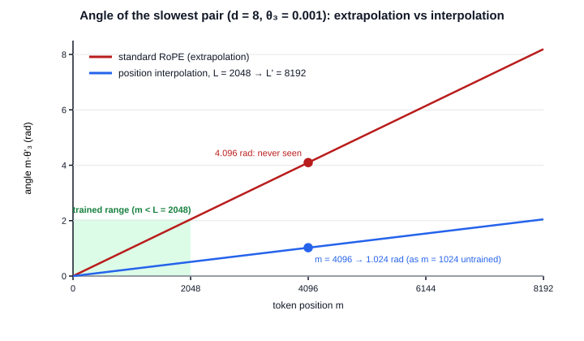

**Trade-offs.** Interpolation divides **every** speed by `s = L'/L`.
Neighbouring tokens now differ by `θⱼ/s`: the local resolution of the fast
pairs drops by the factor `s`. The scaled positions are non-integers
(1024.25, 1024.5, …) that the model never saw. Thus interpolation needs
fine-tuning, and it can reduce short-range precision.

### 12.2 Scaling positions versus scaling inverse frequencies

```math
scaling positions:    φ' = (m · (1/s)) · θⱼ
scaling frequencies:  φ' = m · (θⱼ / s)
```

Multiplication is associative, so both give the **same angle**. Many
implementations call the frequency form "linear scaling" with a
`factor = s`. In floating point the two forms can differ by one rounding;
for `s = 4` both are exact (division by a power of two is exact).

`rust_rope` offers both parameterizations as explicit enum variants, but
implements them with **one** operation on the frequencies, because positions
are integers (`Position`):

- `RopeScaling::PositionInterpolation { original_context, target_context }`
  validates `1 ≤ L ≤ L'` and uses `θ'ⱼ = θⱼ·L/L'`.
- `RopeScaling::Linear { factor }` validates `s ≥ 1` and uses `θ'ⱼ = θⱼ/s`.

The PyTorch reference implements position interpolation by scaling the
**positions**, so the comparison checks the equivalence independently
(Chapter 22).

## Chapter 13: NTK-Aware Scaling

### 13.1 The Neural Tangent Kernel at a high level

The **Neural Tangent Kernel** (NTK, Jacot et al., 2018) describes how a
very wide neural network changes during training. A related result (Tancik
et al., 2020): networks learn high-frequency details poorly from
low-dimensional inputs unless the input already contains high-frequency
features. For RoPE this suggests: **keep the high frequencies**, because
position interpolation destroys exactly the fine detail that the network
cannot easily re-learn. "NTK-aware" refers to this argument. It is a
heuristic, not a theorem.

### 13.2 The formula and its derivation

Instead of dividing all speeds by `s`, change the **base**. Requirements:
the fastest pair stays (`θ'₀ = 1`, automatic because `b'^0 = 1`), and the
slowest pair is fully interpolated (`θ'_(d/2−1) = θ_(d/2−1)/s`). With
exponent `(d − 2)/d` for `j = d/2 − 1`:

```math
b'^(−(d−2)/d) = b^(−(d−2)/d) / s
b'^((d−2)/d)  = b^((d−2)/d) · s
b'            = b · s^(d/(d−2))
θ'ⱼ / θⱼ = (b'/b)^(−2j/d) = s^(−2j/(d−2))
```

This is the static formula of the original post (bloc97, 2023), as written
in the YaRN paper (section 3.1). It needs `d ≥ 4`. The ratio goes
geometrically from 1 (`j = 0`) to `1/s` (last pair).

**Example** (`d = 8`, `b = 10 000`, `s = 4`):

```math
b' = 10000 · 4^(8/6) = 10000 · 6.3496 = 63 496.04
θ' = [1, 0.0630, 0.003969, 0.00025]      θ'/θ = [1, 0.630, 0.397, 0.25]
```

Table: Position interpolation versus NTK-aware scaling

| | Position interpolation | NTK-aware |
|---|---|---|
| Fast pair (`j = 0`) | divided by `s` (resolution lost) | unchanged |
| Slowest pair | divided by `s` | divided by `s` |
| Middle pairs | divided by `s` | divided by `s^(2j/(d−2))` |
| What changes | the positions (or all `θ`) | the base |

**Variants.** "Dynamic NTK" recomputes `s` from the current sequence
length during inference. **It is not implemented.** `RopeScaling::NtkAware`
is the static formula only.

Listing: `src/rope/scaling.rs` — `scaled_inverse_frequencies`

```rust
            let base = config.base() * factor.powf(d as f64 / (d as f64 - 2.0));
            for (j, t) in theta.iter_mut().enumerate() {
                *t = inverse_frequency_unchecked(j, d, base);
            }
```

The NTK branch computes `b'` once and reuses the standard frequency
formula of Chapter 5 with the new base. `iter_mut().enumerate()` gives the
index `j` and a mutable reference `t` to each frequency.

## Chapter 14: YaRN

### 14.1 Frequency-band correction

YaRN ("Yet another RoPE extensioN method", Peng et al., 2023) decides per
pair, from the number of turns that the pair makes in the training context:

```math
λⱼ   = 2π / θⱼ          (wavelength)
r(j) = L / λⱼ           (turns of pair j inside the training context)
```

- `r(j) > β`: the pair turned many times in training: **do not
  interpolate** (high-frequency band).
- `r(j) < α`: less than `α` turns: **interpolate fully** (low-frequency band).
- In between: blend.

The **correction range** is `[α, β]` in units of turns. The paper uses
`α = 1`, `β = 32` for LLaMA models; `rust_rope` provides them as
`YARN_DEFAULT_ALPHA` and `YARN_DEFAULT_BETA` and the constructor
`RopeScaling::yarn(factor, original_context)`.

### 14.2 The blending function

```math
γ(r) = 0                      if r < α
     = 1                      if r > β
     = (r − α) / (β − α)      otherwise
θ'ⱼ = (1 − γ(r(j))) · θⱼ / s  +  γ(r(j)) · θⱼ
```

`γ = 1` keeps the frequency; `γ = 0` interpolates it.

### 14.3 The attention scaling factor

The paper observes that interpolation makes the attention distribution
flatter. YaRN multiplies the logits by `1/t` with `√(1/t) = 0.1·ln(s) + 1`.
Implementations multiply **both** the rotated query and the rotated key by
`√(1/t)` (equivalently: `cos φ` and `sin φ`), so `qᵀk` is multiplied by
`1/t`. `RotaryEmbedding` multiplies the rotated components by
`attention_factor()`. Thus a YaRN rotation is **not length-preserving**;
the pass-through components of partial RoPE are not multiplied.

### 14.4 Numerical example

`d = 8`, `b = 10 000`, `L = 2048`, `s = 4`, `α = 1`, `β = 32`:

Table: YaRN frequencies for d = 8, L = 2048, s = 4

| `j` | `θⱼ` | `λⱼ` | `r(j)` | `γ` | `θ'ⱼ` | `θ'ⱼ/θⱼ` |
|---|---|---|---|---|---|---|
| 0 | 1 | 6.28 | 325.9 | 1 | 1 | 1 |
| 1 | 0.1 | 62.8 | 32.59 | 1 | 0.1 | 1 |
| 2 | 0.01 | 628.3 | 3.259 | 0.0729 | 0.003047 | 0.305 |
| 3 | 0.001 | 6283 | 0.326 | 0 | 0.00025 | 0.25 |

For pair 2: `γ = (3.259 − 1)/31 = 0.0729` and
`θ' = 0.9271·0.0025 + 0.0729·0.01 = 0.003047`. Attention factor:
`0.1·ln 4 + 1 = 1.1386`; score factor `1.1386² = 1.2965`.

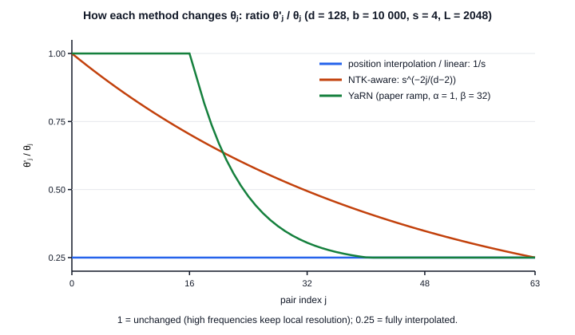

Listing: `src/rope/scaling.rs` — `yarn_ramp`, `scaled_inverse_frequencies`

```rust
fn yarn_ramp(r: f64, alpha: f64, beta: f64) -> f64 {
    if r < alpha {
        0.0
    } else if r > beta {
        1.0
    } else {
        (r - alpha) / (beta - alpha)
    }
}
```

```rust
            let l = original_context as f64;
            for t in theta.iter_mut() {
                let wavelength = TAU / *t; // λⱼ = 2π/θⱼ
                let rotations = l / wavelength; // r(j) = L/λⱼ
                let gamma = yarn_ramp(rotations, alpha, beta);
                *t = (1.0 - gamma) * (*t / factor) + gamma * *t;
            }
```

### 14.5 The exact formulation, and what differs from other code

`rust_rope` implements the **paper's formulation**: a continuous ramp over
the number of turns `r`, and `√(1/t) = 0.1·ln(s) + 1`. The published
reference code and the Hugging Face `transformers` library compute the ramp
differently: they convert the boundaries into **dimension indices**, round
them with `floor` and `ceil`, and ramp linearly over the dimension index,
with extra options (`truncate`, `mscale`, `mscale_all_dim`). This gives
similar but **not identical** frequencies inside the ramp. **`rust_rope`
does not reproduce these details, and this guide does not claim numerical
equality with the Hugging Face output.** The PyTorch reference of this
project implements the paper formulation independently.

### 14.6 The scaling API

Listing: `src/rope/embeddings.rs` — `RotaryEmbedding::with_scaling`

```rust
    pub fn with_scaling(config: RopeConfig, scaling: RopeScaling) -> Result<Self, RopeError> {
        Ok(RotaryEmbedding {
            inverse_frequencies: scaled_inverse_frequencies(&config, &scaling)?,
            config,
            scaling,
            attention_factor: scaling.attention_factor(),
        })
    }
```

`RopeScaling` is an enum whose variants carry exactly the parameters of
their method: `None`, `PositionInterpolation { original_context,
target_context }`, `Linear { factor }`, `NtkAware { factor }`,
`Yarn { factor, original_context, alpha, beta }`. `with_scaling` validates
the method (`?` returns the first error), computes `θ'ⱼ` once, and stores
the attention factor. `RotaryEmbedding::new(config)` is equal to
`with_scaling(config, RopeScaling::None)`; the test
`scaling_none_gives_bit_identical_standard_rope` checks bit equality.

> **Tests:** `position_interpolation_produces_the_expected_angles`,
> `longer_targets_give_slower_frequencies`,
> `different_scaling_methods_are_distinguishable`,
> `invalid_scaling_configurations_return_useful_errors`,
> `scaling_works_with_both_layouts_partial_rope_and_tensors`
> (`tests/rope_tests.rs`); `ntk_aware_for_different_rotary_dimensions`,
> `scaling_is_numerically_stable_at_large_positions`,
> `relative_position_property_holds_with_scaling`
> (`tests/numerical_tests.rs`).

# Part V — Rust Engineering

## Chapter 15: Rust Project Architecture

### 15.1 Directory structure

```text
rust_rope/
├── Cargo.toml              package definition (no runtime dependencies)
├── CLAUDE.md               permanent project rules
├── README.md, explain.md   overview and learning journal (Entries 1–16)
├── src/
│   ├── lib.rs              library root: pub mod math, rope, utils
│   ├── main.rs             thin demonstration binary
│   ├── math/               general mathematics (no RoPE knowledge)
│   ├── rope/               RoPE-specific logic
│   └── utils/validation.rs input checks and RopeError
├── tests/                  integration tests (public API only)
├── examples/               runnable example programs
├── benches/                benchmark (std::time, harness = false)
├── reference/              independent PyTorch reference (validation tooling)
├── scripts/                diagram and PDF generation for this guide
└── docs/                   mathematics, architecture, references, this guide
```

A Cargo **package** contains several **crates** (compilation units): the
library (`src/lib.rs`), the binary (`src/main.rs`), each file in `tests/`,
each example and the benchmark. All logic is in the library, because the
other crates can use only the library.

### 15.2 File responsibilities

Table: Source files, their mathematics and their Rust concepts

| File | Responsibility | Mathematical concept | Rust concepts |
|---|---|---|---|
| `src/math/mod.rs` | `approx_eq`, `DEFAULT_TOLERANCE` | floating-point tolerance | free functions, constants |
| `src/math/trigonometry.rs` | angle conversion, `sin_cos`, unit circle | radians, sine, cosine | tuples, `#[inline]` |
| `src/math/matrix.rs` | `Vector`, `Vector2`, `Matrix2`, `rotate_vector` | dot product, norm, rotation matrix | `Vec<f64>`, arrays, `Copy`, `Result` |
| `src/math/complex.rs` | `Complex`, `from_polar`, `rotate` | complex numbers, Euler's formula | operator traits (`Add`, `Mul`) |
| `src/math/tensor.rs` | `TensorShape`, `Tensor4`, `TensorError` | row-major indexing, strides | private fields, `&mut`, `impl FnMut` |
| `src/rope/config.rs` | `RopeConfig`, `RopeLayout`, `DEFAULT_BASE` | `d`, `b`, `D`, layout | validated constructor, enum, `..self` |
| `src/rope/frequencies.rs` | `θⱼ`, `angle`, `AngleTable` | inverse frequencies, angles | iterators, `pub(crate)`, slices |
| `src/rope/position.rs` | `Position`, `PositionRange` | token positions, `2^53` limit | newtype, `impl Iterator`, checked arithmetic |
| `src/rope/rotations.rs` | `rotate_pair` | 2-D rotation of a pair | `Copy` arrays, reuse |
| `src/rope/embeddings.rs` | `RotaryEmbedding` (vectors, tensors, layouts, partial, scaling) | `R_m·x`, relative position | `chunks_exact_mut`, `zip`, `split_at_mut`, `match` |
| `src/rope/scaling.rs` | `RopeScaling`, `scaled_inverse_frequencies` | PI, linear, NTK-aware, YaRN | enum with data, field binding |
| `src/utils/validation.rs` | `RopeError`, `validate_*` | the domain rules | enum errors, `Display`, `Error` |

### 15.3 Data flow and dependency direction

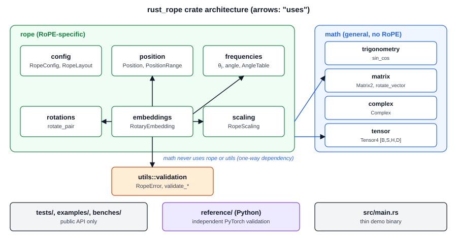

The dependency direction is one-way: `rope → math` and `rope → utils`.
`math` is general and can be tested alone. Inside `rope`, `embeddings`
uses `config`, `frequencies`, `position`, `rotations` and `scaling`. The
dataflow is: configuration → frequencies (optionally scaled) → positions →
angles → pair rotations → vectors or tensors. Chapter 20 traces one call
through all of these files.

## Chapter 16: Rust Fundamentals Used in This Project

This chapter explains each Rust concept with real project code: what it
means, why Rust has it, where it appears, what happens in memory, and which
problem it solves.

### 16.1 `struct`, `impl`, methods and associated functions

A **struct** groups named fields into one type. An **`impl` block** adds
functions to it. A function with a `self` parameter is a **method**
(`config.base()`); a function without `self` is an **associated function**
(`RopeConfig::new(8, 10_000.0)`).

Listing: `src/rope/config.rs` — `RopeConfig::new`

```rust
    pub fn new(dimension: usize, base: f64) -> Result<Self, RopeError> {
        validate_dimension(dimension)?;
        validate_base(base)?;
        Ok(RopeConfig {
            dimension,
            base,
            head_dimension: dimension,
            layout: RopeLayout::Interleaved,
        })
    }
```

**Memory:** `RopeConfig` holds two `usize`, one `f64` and one enum: a few
dozen bytes on the stack, no heap. **Problem solved:** the fields are
private, so the only way to create a `RopeConfig` is this checked
constructor. Every `RopeConfig` that exists is valid ("validate one time,
then trust the type").

### 16.2 `enum` and pattern matching

An **enum** is a type with a fixed set of variants; a value is exactly one
of them. Variants can carry data. `match` compares a value with patterns and
must be **exhaustive**: every variant must be handled, or the code does not
compile.

Examples in the project: `RopeLayout { Interleaved, SplitHalf }`,
`RopeScaling { None, PositionInterpolation {…}, Linear {…}, NtkAware {…},
Yarn {…} }`, `RopeError` (one variant per kind of invalid input) and
`TensorError`. The pattern `RopeScaling::Linear { factor }` **binds** the
field to a variable; `..` ignores remaining fields; `_` matches anything.

**Memory:** an enum is as large as its largest variant plus a tag (the
compiler often hides the tag in unused bits). **Problem solved:** no
invalid combinations (a `Linear` value has no `alpha`), no string typing
mistakes, and the compiler finds every `match` that must change when a
variant is added.

### 16.3 Modules and visibility

`pub mod math;` in `src/lib.rs` declares a module and makes it public.
Items are **private by default**. `pub` makes an item visible outside its
module. `pub(crate)` makes it visible inside the crate only: the helpers
`inverse_frequency_unchecked` and `angle_unchecked` skip validation, so they
must not be public. Private fields (`RopeConfig`, `Tensor4`,
`RotaryEmbedding`) protect invariants.

### 16.4 `Vec<T>`, slices and references

`Vec<f64>` is a growable array: a 24-byte header on the stack (pointer,
capacity, length) and a heap block. A **slice** `&[f64]` is a borrowed view
of contiguous values (pointer + length, 16 bytes); `&mut [f64]` allows
writing. A **reference** `&T` borrows a value for reading; `&mut T` borrows
it for writing.

```rust
let v = vec![1.0, 2.0, 3.0, 4.0];
let part: &[f64] = &v[1..3];   // [2.0, 3.0], no copy
```

In the project: `rotate(&self, embedding: &[f64], …)` reads a borrowed
input; `rotate_in_place(&self, embedding: &mut [f64], …)` writes into it;
`Tensor4::vector(b, s, h) -> Option<&[f64]>` returns a view into the
tensor without a copy.

### 16.5 Ownership, borrowing and lifetimes

**Ownership:** each value has exactly one owner; when the owner goes out of
scope, the value is dropped (its heap memory is freed). **Move:** assigning
a non-`Copy` value moves ownership; the old variable can no longer be used.
**Borrowing rules:** at one time, a value has either many `&` borrows or
one `&mut` borrow.

`Tensor4::new(shape, data: Vec<f64>)` takes ownership of the buffer: only
the header moves into the tensor; the data is not copied.
`into_vec(self)` gives it back. A real error that the compiler found while
writing the tests:

```rust
assert_eq!((q2, k2), (q3, k3));   // moves q3 and k3 into a tuple
assert_eq!(single, q3);            // error[E0382]: borrow of moved value: `q3`
```

The fix compares references: `assert_eq!((&q2, &k2), (&q3, &k3))`.

**Lifetimes** tell the compiler how long a reference is valid. Most are
**elided** (inferred): `fn row(&self, …) -> Option<&[f64]>` means "the
returned slice borrows `self`". While that slice exists, the table cannot
change or be dropped.

**Problem solved:** no use-after-free, no data races, no dangling pointers,
at compile time and without a garbage collector.

### 16.6 Traits and generics

A **trait** is a set of methods that a type can implement. The project
implements `Add`, `Sub` and `Mul` for `Complex` (operator overloading),
`Display` and `std::error::Error` for the error types, and derives `Debug`,
`Clone`, `Copy`, `PartialEq`, `Eq`, `Default`, `PartialOrd` and `Ord` where
they are meaningful (`f64` types cannot be `Eq`, because `NaN ≠ NaN`).

**Generics** let one function work with many types. `Tensor4::from_fn`
accepts `impl FnMut(usize, usize, usize, usize) -> f64`: any closure with
this signature. The compiler creates one copy of `from_fn` per closure type
(**monomorphization**), so the call is direct and can be inlined. The
project does not add generic or trait abstractions without a real need;
for example, `RopeLayout` is an enum, not a trait with two types.

### 16.7 Iterators and closures

An **iterator** produces values one at a time through `next()`. Iterators
are **lazy**: `map` does nothing until a consumer (`for`, `collect`,
`count`) asks for values. **Closures** are anonymous functions that can
capture variables: `|j| inverse_frequency_unchecked(j, dimension, base)`
captures `dimension` and `base`.

Table: Iterator adapters used in the project

| Adapter | Meaning | Use in the project |
|---|---|---|
| `map(f)` | apply `f` to each item | frequencies, `PositionRange::iter` |
| `zip(other)` | walk two iterators together | pairs with `θⱼ`, tokens with positions |
| `enumerate()` | add the index `(0, x0), (1, x1), …` | validation, NTK frequencies |
| `chunks_exact_mut(n)` | non-overlapping mutable chunks of `n` | pairs, heads, tokens, batch elements |
| `iter_mut()` | mutable references to each element | split-half halves, scaling |
| `windows(2)` | overlapping neighbours | tests of monotone sequences |
| `collect()` | build a collection | `Vec<f64>` of frequencies |

The optimized machine code of such a chain is usually the same as a
hand-written loop.

### 16.8 `Result`, `Option` and error handling

`Option<T>` is `Some(value)` or `None`: "there may be no value"
(`Tensor4::get` out of range). `Result<T, E>` is `Ok(value)` or `Err(error)`:
"the operation can fail". The `?` operator returns an `Err` (or `None`)
early and otherwise unwraps the value. The project returns `Result` for
every error that a caller can cause and uses `panic!` (through
`debug_assert!`) only for internal bugs. Chapter 19 lists the errors.

### 16.9 `Copy` and `Clone`

A `Copy` type is duplicated by a bitwise copy when it is assigned or passed;
the original stays usable (`f64`, `[f64; 2]`, `Position`, `PositionRange`,
`RopeConfig`, `RopeScaling`, `Complex`, `Matrix2`). `Clone` is an explicit,
possibly expensive copy (`Tensor4::clone` copies the heap buffer). The
project clones only when the caller keeps the original
(`rotate_query_key`); the in-place methods never clone.

## Chapter 17: Stack, Heap and Memory Layout

### 17.1 Stack and heap

The **stack** stores local variables of fixed size. Allocation is a
pointer adjustment, and the memory is freed automatically when the function
returns. The **heap** stores data whose size is known only at run time.
Allocation and deallocation go through the allocator, which costs time.

Table: Where the main project values live

| Value | Size | Location |
|---|---|---|
| `Position` | 8 B | stack / register |
| `PositionRange` | 16 B | stack |
| `[f64; 2]` (a pair) | 16 B | stack / registers |
| `Matrix2` | 32 B | stack |
| `Vec<f64>` header | 24 B | stack (data on the heap) |
| `Tensor4` | 56 B header (32 B shape + 24 B `Vec`) | stack, data `B·S·H·D·8` B on the heap |
| `RotaryEmbedding` | config, scaling, factor and a `Vec` header | stack, `d/2·8` B of frequencies on the heap |

### 17.2 `Vec<f64>`: capacity and length

The **length** is the number of values in use; the **capacity** is the
number that fit in the allocated block. When `push` exceeds the capacity,
the `Vec` allocates a larger block, copies the values and frees the old
block (**reallocation**). `Vec::with_capacity(n)` and `collect` from an
exact-size iterator allocate the final size once. When the `Vec` is
dropped, its block is freed.

### 17.3 The flat tensor in memory

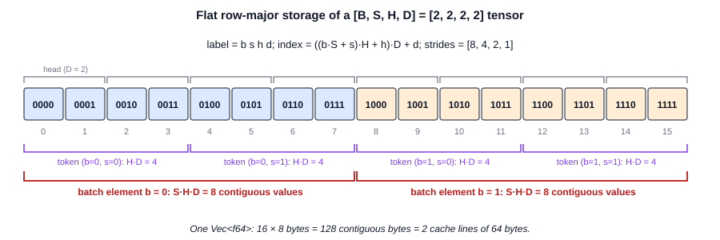

The logical shape `[B, S, H, D]` maps to one contiguous block. One head
vector (`D` values) is contiguous; one token (`H·D` values) is contiguous;
one batch element (`S·H·D` values) is contiguous. A `[2, 512, 16, 64]`
tensor uses `2·512·16·64·8 = 8 MiB` in one allocation.

**Copying and cloning.** `rotate_query_key` clones `q` and `k`: two
allocations and two copies of the whole buffer. `rotate_query_key_in_place`
writes into the existing buffers. A pair is copied into registers, rotated
and written back; it never touches the heap allocator.

## Chapter 18: Tensor Indexing and Data Structures

### 18.1 Derivation of the flat index

Row-major order: the last index changes fastest. Count the values before
element `(b, s, h, d)`:

1. `b` complete batch elements of `S·H·D` values: `b·S·H·D`.
2. `s` complete tokens of `H·D` values: `s·H·D`.
3. `h` complete heads of `D` values: `h·D`.
4. `d` values inside the head.

```math
index = b·S·H·D + s·H·D + h·D + d = ((b·S + s)·H + h)·D + d
```

The second form (Horner form) needs only three multiplications.
**Strides** are the index steps per axis: `[S·H·D, H·D, D, 1]`.

### 18.2 Manual calculations

Table: Flat indices of a [2, 4, 2, 4] tensor (strides [32, 8, 4, 1])

| `(b, s, h, d)` | Calculation | Index |
|---|---|---|
| (0, 0, 0, 0) | `((0·4 + 0)·2 + 0)·4 + 0` | 0 |
| (0, 0, 1, 0) | `((0·4 + 0)·2 + 1)·4 + 0` | 4 |
| (0, 1, 0, 2) | `((0·4 + 1)·2 + 0)·4 + 2` | 10 |
| (1, 0, 0, 0) | `((1·4 + 0)·2 + 0)·4 + 0` | 32 |
| (1, 2, 1, 3) | `((1·4 + 2)·2 + 1)·4 + 3` | 55 |
| (1, 3, 1, 3) | `((1·4 + 3)·2 + 1)·4 + 3` | 63 (the last) |

The unit test `index_formula_matches_memory_order` in `src/math/tensor.rs`
fills a tensor with a counter in memory order and checks the formula for
every element of a `[2, 3, 4, 5]` tensor.

### 18.3 Nested vectors versus a flat vector

Table: Nested Vec versus flat Vec

| | `Vec<Vec<Vec<Vec<f64>>>>` | flat `Vec<f64>` (chosen) |
|---|---|---|
| Allocations | `B·S·H + B·S + B + 1` | 1 |
| Memory | scattered rows, pointer chasing | one contiguous block |
| Indexing | `t[b][s][h][d]` (4 pointer loads) | index arithmetic or nested chunks |
| Shape consistency | rows can have different lengths | guaranteed by the constructor |
| Sub-blocks as one slice | not possible across rows | any head, token or batch element |
| Transfer to SIMD, threads, GPU | needs a copy into a flat buffer | direct (one contiguous buffer) |

The flat layout is also the layout of PyTorch, NumPy and GPU buffers. It
allows SIMD loads of neighbouring values, a split into contiguous parts for
threads, and one transfer to a device. These are reasons for the later
optimization stages; they are **not implemented** yet.

## Chapter 19: Error Handling and Validation

### 19.1 Validation at the API boundary

Validation happens once, where data enters the library: in constructors
(`RopeConfig::new`, `Position::new`, `PositionRange::new`, `Tensor4::new`,
`RotaryEmbedding::with_scaling`) and at the start of public methods. Inner
loops trust the validated types. This keeps the hot loops free of checks,
and an error never leaves a half-modified tensor (`rotate_query_key_in_place`
checks both tensors before it writes).

Listing: `src/utils/validation.rs` — `validate_base`

```rust
pub fn validate_base(base: f64) -> Result<(), RopeError> {
    if base > 1.0 && base.is_finite() {
        Ok(())
    } else {
        Err(RopeError::InvalidBase { base })
    }
}
```

Every comparison with NaN is false. The condition is written for the
**valid** case, so NaN falls into the error branch. (`if base <= 1.0
{ error }` would accept NaN.)

### 19.2 The error types

Table: Errors returned by the library

| Error | Cause |
|---|---|
| `RopeError::ZeroDimension`, `OddDimension` | rotary dimension 0 or odd |
| `RopeError::InvalidBase` | base not finite or `≤ 1` |
| `RopeError::PairIndexOutOfRange` | `j ≥ d/2` in `inverse_frequency` |
| `RopeError::PositionTooLarge`, `SequenceTooLong` | position above `2^53` |
| `RopeError::EmptyFrequencies`, `InvalidInverseFrequency` | invalid frequency list for `AngleTable` or `angle` |
| `RopeError::TableTooLarge` | `L·P` overflows `usize` |
| `RopeError::EmbeddingDimensionMismatch` | vector or head length `≠ D` |
| `RopeError::QueryKeyShapeMismatch` | `q` and `k` with different `B` or `S` |
| `RopeError::RotaryDimensionTooLarge` | `d > D` |
| `RopeError::InvalidScalingFactor` | factor not finite or `< 1` |
| `RopeError::InvalidContextLengths` | `L = 0` or `L' < L` |
| `RopeError::InvalidYarnRange` | not `0 ≤ α < β` (finite) |
| `RopeError::NtkRequiresLargerDimension` | NTK-aware with `d = 2` |
| `TensorError::ZeroExtent`, `TooManyElements`, `LengthMismatch` | invalid tensor shape or data length |

`RopeError` implements `Display` (a readable message with the invalid
value) and `std::error::Error`, so `?` converts it into
`Box<dyn std::error::Error>` in programs. `TensorError` is separate because
`math` must not depend on `utils`.

### 19.3 Why `Result` is useful

The caller cannot ignore a `Result` silently (the compiler warns), the
error carries the invalid value, and the program does not crash for bad
input. Example message (from the test `errors_have_readable_messages`):

```text
the embedding dimension 7 is odd; RoPE needs an even dimension, because it rotates the dimensions in pairs
```

## Chapter 20: Code Walkthrough

This chapter traces one complete operation through the real code:
query and key tensors with the shape `[2, 4, 2, 8]`, rotary dimension 8,
base 10 000, start position 0.

```rust
let config = RopeConfig::new(8, 10_000.0)?;                   // step 1
let rope = RotaryEmbedding::new(config);                       // step 2
let shape = TensorShape::new(2, 4, 2, 8);
let mut q = Tensor4::from_fn(shape, |b, s, h, d| (b + s + h + d) as f64)?;
let mut k = q.clone();
rope.rotate_query_key_in_place(&mut q, &mut k, Position::ZERO)?;   // steps 3–9
```

Table: The execution path of rotate_query_key_in_place

| Step | File | Function | Input → output | Mathematics | Rust concepts |
|---|---|---|---|---|---|
| 1 Configuration | `src/rope/config.rs` | `RopeConfig::new` | `(8, 10000)` → `RopeConfig` | `d` even, `b > 1` | validated constructor, `?` |
| 2 Frequencies | `src/rope/frequencies.rs` | `inverse_frequencies` (called by `RotaryEmbedding::new`) | config → `[1, 0.1, 0.01, 0.001]` | `θⱼ = b^(−2j/d)` | iterator, `collect`, one allocation |
| 3 Validation | `src/rope/embeddings.rs` | `check_query_key`, `check_tensor` | shapes → `Ok` or `Err` | `D = d`, equal `B`, `S` | `Result`, early return |
| 4 Positions | `src/rope/position.rs` | `PositionRange::new`, `iter` | `(0, 4)` → `0, 1, 2, 3` | `m = start + s` | newtype, lazy iterator |
| 5 Tensor traversal | `src/rope/embeddings.rs` | `rotate_tensor_unchecked` | `&mut Tensor4` → head slices | `[B, S, H, D]` row-major | nested `chunks_exact_mut`, `zip` |
| 6 Angles | `src/rope/frequencies.rs` | `angle_unchecked` | `(m, θⱼ)` → `φ` | `φ = m·θⱼ` | `pub(crate)`, `Copy` |
| 7 Sine and cosine | `src/math/trigonometry.rs` | `sin_cos` | `φ` → `(sin φ, cos φ)` | unit circle | tuple |
| 8 Pair rotation | `src/rope/rotations.rs`, `src/math/matrix.rs` | `rotate_pair` → `rotate_vector` → `Matrix2::rotation`, `mul_vector` | `[x, y]` → `[x', y']` | `R(φ)·[x, y]` | arrays by value |
| 9 Write back | `src/rope/embeddings.rs` | `rotate_pairs` | rotated pair → same two slots | `× attention factor` (1.0 here) | `&mut` writes, `match` on layout |

**Output.** For token `s = 0` (position 0) every angle is 0, so
`q[b, 0, h, :]` is unchanged. For `s = 1`, pair 0 of every head rotates by
1 rad, pair 3 by 0.001 rad. `v` (if the caller has one) was never passed to
RoPE. No allocation happens in steps 3–9.

# Part VI — Numerical Correctness and Validation

## Chapter 21: Floating-Point Arithmetic

### 21.1 IEEE 754, f32 and f64

Computers store real numbers in **floating-point** format, defined by the
IEEE 754 standard:

```math
value = (−1)^sign × 1.fraction × 2^(exponent − bias)
```

Table: The two floating-point types

| Type | Bits | Exponent bits | Fraction bits | Significant bits | Machine epsilon ε |
|---|---|---|---|---|---|
| `f32` (`float32`) | 32 | 8 | 23 | 24 | `2^−23 ≈ 1.19 × 10⁻⁷` |
| `f64` (`float64`) | 64 | 11 | 52 | 53 | `2^−52 ≈ 2.22 × 10⁻¹⁶` |

**Machine epsilon** `ε` is the distance from 1.0 to the next larger
representable number. Every basic operation (`+ − × ÷ √`) returns the exact
result **rounded to the nearest** representable number: a relative error of
at most `ε/2` ("one unit in the last place", one ulp). `rust_rope` uses
`f64` everywhere, as an accurate reference for later `f32` work.

### 21.2 Examples of floating-point limits

- `0.1 + 0.2 = 0.30000000000000004`, and `3 · 0.1 = 0.30000000000000004`:
  `0.1` has no exact binary representation (it is stored as
  `0.1000000000000000055511…`).
- `sin(PI) = 1.2246 × 10⁻¹⁶`, because `PI` in `f64` is not exactly `π`.
- Integers up to `2^53` are exact in `f64`; `2^53 + 1` converts to `2^53`.
  Thus `Position::new` rejects positions above `2^53`
  (`MAX_POSITION` in `src/utils/validation.rs`): two different positions
  must not get the same angle.
- Large angles lose absolute precision: the error of `φ = m·θ` is about
  `ε·φ`. `sin(2π·10⁶)` in `f64` gives `−4.46 × 10⁻¹⁰` instead of 0.

### 21.3 Accumulated error

Errors accumulate over many operations. The test
`many_small_rotations_drift_more_than_one_large_rotation` rotates `[1, 0]`
10 000 times by 0.001: the length error is `7.8 × 10⁻¹⁴`. One rotation by
10.0 has a length error of 0. **Consequence for RoPE:** compute `R(m·θ)`
directly from the angle `m·θ`; do not compute it as `R(θ)^m`. `rust_rope`
always computes the angle directly.

The composition `RoPE(RoPE(x, m), n)` versus `RoPE(x, m + n)` uses
`m·θ + n·θ` versus `(m + n)·θ`. Measured largest component difference:
`4.4 × 10⁻¹⁶` at `m + n = 13`, `2.6 × 10⁻¹²` at 133 333, `3.9 × 10⁻¹¹` at
1 333 333. The length is always kept within a few `ε`.

### 21.4 Why bitwise equality is not expected

Two mathematically equal implementations can round differently:

1. **Different formula forms:** `b.powf(−x)` (Rust, one rounding) versus
   `1 / b^x` (PyTorch reference, two roundings). They differ by one ulp for
   24 of the 64 values of `θⱼ` with `d = 128`.
2. **Different library functions:** different `sin` and `cos`
   implementations, each accurate to about one ulp.
3. **Different operation order** in sums and products.

Thus tests compare with a **tolerance**. `approx_eq(a, b, tol)` in
`src/math/mod.rs` tests `|a − b| ≤ tol · max(1, |a|, |b|)`: absolute near
zero, relative for large values; `DEFAULT_TOLERANCE = 1e−12`.

## Chapter 22: Python and PyTorch Reference Validation

### 22.1 Why an independent reference

Property tests (length preservation, composition, relative position) cannot
find a wrong **convention** that keeps the properties: a wrong frequency
formula or a wrong layout still keeps every length. An **independent
reference** finds such errors: two implementations written separately are
unlikely to contain the same mistake.

`reference/pytorch_rope.py` is **validation tooling, not production code**.
It never calls Rust. It uses a different frequency form
(`1 / base^(arange(0, r, 2)/r)`), whole-tensor PyTorch operations
(`reshape`, `stack`, `cat`, broadcasting) instead of a loop over pairs, the
`rotate_half` form for split-half, and for position interpolation it scales
the **positions**, while Rust scales the frequencies. PyTorch 2.15.0 (CPU)
runs in the project-local virtual environment `reference/.venv`.

### 22.2 Data exchange

```text
cargo run --example export_reference_cases          → reference/data/rust_cases.txt
reference/.venv/Scripts/python reference/compare_rope.py
reference/.venv/Scripts/python -m unittest discover -s reference
```

`examples/export_reference_cases.rs` generates **deterministic** inputs
(`2·sin(0.731k + seed) + 0.25·cos(1.37k)`, no random numbers), runs the Rust
code, and writes one text block per case:

```text
case name=… api=vector|tensor base=10000.0 layout=interleaved rotary_dim=8 shape=2,4,2,8 start=3 scaling=none
input  <B·S·H·D values>
output <B·S·H·D values>
end
```

Rust prints each `f64` with `{:?}`: the **shortest** decimal text that
converts back to the identical value. Python's `float()` reads it back
exactly, so the exchange adds no rounding error and needs no serialization
library.

### 22.3 Error measures and tolerances

```math
max_error  = maxₖ |rₖ − pₖ|
mean_error = (1/N) Σₖ |rₖ − pₖ|
max_rel    = maxₖ |rₖ − pₖ| / |pₖ|      (only where |pₖ| ≥ 10⁻³ · max|p|)
```

**Absolute error** is in the units of the data; **relative error** is a
fraction of the value. Near zero, relative error misleads: a reference
value of `10⁻¹⁵` (a zero with a rounding residue) and a Rust value of
`2 × 10⁻¹⁵` have a relative error of 100 %, although both are correct.

The tolerance comes from an error model (Chapter 21), not from tuning:

```math
tol = 8 · ε · (1 + max_angle) · max(1, max|x|)
```

`ε` is the epsilon of the reference dtype, `max_angle` the largest angle of
the case, `max|x|` the largest input magnitude, and 8 covers the few
roundings in `θ`, `φ`, `cos`, `sin` and the multiply-add. In float32 mode,
PyTorch computes in float32 and Rust stays in float64; the difference then
measures the error of float32 RoPE.

### 22.4 Results

Table: PyTorch comparison results (288 cases, all pass)

| Group | Cases | float64 max abs error | float32 max abs error |
|---|---|---|---|
| Stage 6: interleaved, full (vectors `d = 2…128`, tensors) | 66 | `1.9 × 10⁻¹¹` | `1.1 × 10⁻²` |
| Stage 7: split-half, full | 36 | `1.6 × 10⁻¹³` | `5.7 × 10⁻⁵` |
| Stage 7: split-half, partial | 25 | `7.6 × 10⁻¹⁴` | `6.0 × 10⁻⁴` |
| Stage 7: interleaved, partial | 25 | `1.6 × 10⁻¹³` | `6.9 × 10⁻⁴` |
| Stage 8: position interpolation 2048 → 8192 | 16 | `2.5 × 10⁻¹³` | `2.5 × 10⁻⁴` |
| Stage 8: linear `s = 4` | 16 | `2.5 × 10⁻¹³` | `2.5 × 10⁻⁴` |
| Stage 8: NTK-aware `s = 4` | 16 | `2.2 × 10⁻¹²` | `1.2 × 10⁻³` |
| Stage 8: YaRN `s = 4`, `L = 2048` | 16 | `1.1 × 10⁻¹²` | `1.5 × 10⁻³` |
| Stage 8: YaRN `s = 16`, `L = 4096` | 16 | `1.3 × 10⁻¹²` | `1.7 × 10⁻³` |

(The Stage 8 table shows a selection; all 8 scaling settings pass.) Worst
over all 288 cases: float64 `1.94 × 10⁻¹¹` (max), `6.84 × 10⁻¹³` (largest
mean), `3.62 × 10⁻¹¹` (max relative); float32 `1.15 × 10⁻²`,
`4.34 × 10⁻⁴`, `8.78 × 10⁻²`.

**Failure analysis of the largest float64 difference.** For `d = 2` and
`d = 8`, the float64 error is exactly 0, even at `m = 100 000`; for
`d = 128` it is `1.9 × 10⁻¹¹`. Before drawing a conclusion, we compared the
two frequency forms: they are identical for `d = 8` but differ by one ulp
for 24 of 64 values with `d = 128`, which gives an angle difference of
`5.6 × 10⁻¹²` at `m = 10⁵`, times `max|x| ≈ 2.25`. **Root cause: expected
rounding, not a bug.**

**Negative controls** (`reference/test_pytorch_rope.py`, 16 tests in
total): with a wrong layout, a wrong base, a wrong start position or a
missing scaling method, the difference becomes larger than `10⁻³`. A
comparison that cannot fail would prove nothing.

## Chapter 23: Testing Strategy

### 23.1 Test layers

Table: Test layers of the project

| Layer | Location | Count | What it proves |
|---|---|---|---|
| Unit tests | `#[cfg(test)]` modules in `src/` | 171 | each function, including private helpers and edge cases |
| Numerical / invariant tests | `tests/numerical_tests.rs` | 43 | mathematical properties across modules |
| API tests | `tests/rope_tests.rs` | 58 | public behaviour, shapes, errors, isolation |
| Documentation tests | examples in `///` comments | 26 | every documented example compiles and runs |
| Python reference self-tests | `reference/test_pytorch_rope.py` | 16 | the reference itself; negative controls |
| PyTorch comparison | `reference/compare_rope.py` | 288 cases × 2 dtypes | agreement with an independent implementation |
| Property-based tests (random generation) | — | — | **not present**; the tests use deterministic tables of cases instead |
| Performance regression tests | — | — | **not present** (Stage 9 is planned) |

All Rust tests pass (`cargo test`: 171 + 43 + 58 + 26 = 298) and all Python
tests and comparison cases pass, at the time of generation.

### 23.2 Important test cases

Table: Important test cases and what they prove

| Test | File | Proves |
|---|---|---|
| `invariant_a_position_zero_is_the_identity` | `tests/numerical_tests.rs` | `RoPE(x, 0) = x` exactly |
| `invariant_b_pair_magnitudes_are_preserved` | `tests/numerical_tests.rs` | every pair keeps its length, up to `m = 10⁶` |
| `invariant_c_embedding_rotations_compose` | `tests/numerical_tests.rs` | `RoPE(RoPE(x, m), n) = RoPE(x, m + n)` |
| `invariant_d_each_pair_gets_its_own_angle` | `tests/numerical_tests.rs` | pair `j` gets exactly `m·θⱼ`; other pairs stay 0 |
| `invariant_e_large_positions_and_bases` | `tests/numerical_tests.rs` | error growth follows the bound `4ε(m + n + 10)·max|x|` |
| `tensor_test_c_relative_position_property` | `tests/numerical_tests.rs` | `(R(m)q)ᵀ(R(n)k) = qᵀR(n − m)k` on tensors |
| `value_tensor_is_preserved` | `tests/rope_tests.rs` | V is unchanged |
| `batch_isolation`, `head_isolation` | `tests/rope_tests.rs` | no influence across batch elements or heads |
| `layouts_are_equivalent_after_a_permutation` | `tests/rope_tests.rs` | split-half = permuted interleaved, bit for bit |
| `partial_rope_rotates_only_the_rotary_part` | `tests/rope_tests.rs` | pass-through values are bit-for-bit unchanged |
| `scaling_none_gives_bit_identical_standard_rope` | `tests/rope_tests.rs` | scaling does not change standard RoPE |
| `position_interpolation_equals_standard_rope_at_the_scaled_position` | `tests/numerical_tests.rs` | PI at `m` = standard RoPE at `m/4` |

**Tolerance rules.** Exact equality (`assert_eq!`) is used only when the
mathematics guarantees exact results in IEEE 754 (position 0, `1·θ`,
copies, the pass-through part, identical operation sequences). All other
comparisons use `approx_eq` with a tolerance and a comment that explains
it.

**A test that found our own mistake.** The first version of
`split_half_numerical_example` contained expected constants that had not
been calculated. The test failed; the constants were replaced with values
from an independent Python `math` calculation (`explain.md`, Entry 14).

# Part VII — CPU Performance Engineering

> **Status of this part.** Stage 9 (CPU performance engineering) is
> **planned and not started**. This part explains the concepts, describes
> how the **current** implementation behaves, and reports the measurements
> of the existing simple benchmark (`benches/rope_benchmark.rs`). SIMD,
> Rayon, `sin`/`cos` caches, loop variants, Criterion and build-flag
> experiments are **not implemented** and **not measured**.

## Chapter 24: Understanding CPU Performance

### 24.1 Cores, threads and registers

A **core** executes instructions. The benchmark computer has an AMD Ryzen 7
6800H with 8 cores and 16 hardware **threads** (two per core, reported by
Windows). A program thread runs on one core at a time. `rust_rope` is
single-threaded. **Registers** are the fastest storage, inside the core:
x86-64 has 16 general-purpose and 16 vector registers (with AVX2, 256 bits
each). In the RoPE loop, a pair, its angle, `sin`, `cos` and the results
live in registers.

### 24.2 The cache hierarchy

Table: Memory hierarchy of the benchmark computer

| Level | Size | Source of the number |
|---|---|---|
| L1 data cache | 32 KiB per core | AMD Zen 3+ specification |
| L2 cache | 512 KiB per core (4 MiB total) | reported by Windows |
| L3 cache | 16 MiB shared | reported by Windows |
| Main memory | 15.2 GiB | reported by Windows |

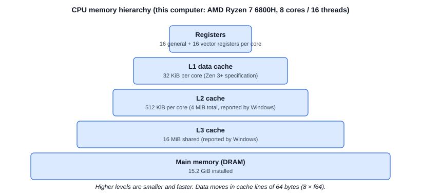

Memory moves between the levels in **cache lines** of 64 bytes (8 `f64`).
**Memory bandwidth** is the rate at which data can move from main memory to
the core. **Spatial locality:** when a program reads one value, the next
values of the same cache line are already loaded; sequential access uses
every byte of every line, and the hardware **prefetcher** loads the next
lines early. **Temporal locality:** a value used again soon is still in a
fast cache.

### 24.3 The connection to RoPE

- The tensor loop reads and writes each head vector once, in increasing
  memory order: perfect spatial locality, no temporal reuse of the data.
- The frequencies (`d/2` values, 512 B for `d = 128`) are read for every
  head vector: they stay in L1 (temporal locality).
- A `[2, 512, 16, 128]` tensor (16 MiB) is as large as the L3 cache, so
  the data must come from main memory at least partly.

## Chapter 25: Allocation and Memory Optimization

### 25.1 What the current implementation does

Table: Allocations of the current API

| Call | Heap allocations | Copies of the data |
|---|---|---|
| `RotaryEmbedding::new` / `with_scaling` | 1 (`d/2` frequencies), one time | none |
| `rotate(&x, m)` | 1 (`to_vec`, `D` values) | 1 |
| `rotate_in_place(&mut x, m)` | 0 | 0 |
| `rotate_tensor_in_place` | 0 | 0 |
| `rotate_query_key_in_place` | 0 | 0 |
| `rotate_query_key(&q, &k)` | 2 (clones) | 2 |
| `PositionRange::iter` | 0 (lazy) | — |

There are no allocations inside any loop, no repeated cloning, and no
recalculation of frequencies (they are computed once per
`RotaryEmbedding`).

### 25.2 In-place operation versus a new output

An in-place function takes `&mut [f64]` or `&mut Tensor4`. It needs no
allocation, but the caller loses the old values. A copying function takes
`&[f64]` or `&Tensor4` and returns a new `Vec` or tensor: safer for the
caller, but it costs an allocation and a full copy. Rust makes in-place
mutation safe: while the function holds `&mut`, no other code can read or
write the data, and two `&mut` borrows of the same tensor are rejected at
compile time. The project keeps both APIs; the convenient one is not
removed for speed.

**Measured** (Chapter 30): rotating `q` and `k` with two clones costs 2.5 to
2.8 times the time of rotating one tensor in place. The clone adds about
3 ns per pair on top of the rotation itself.

## Chapter 26: Trigonometric Precomputation

### 26.1 What the implementation does now

RoPE needs `cos(m·θⱼ)` and `sin(m·θⱼ)`. The current implementation:

- precomputes the **frequencies** `θⱼ` once (`RotaryEmbedding`);
- computes the **angle** `m·θⱼ` and **one combined** `sin_cos` call per
  pair, for every head vector.

Thus a `[B, S, H, D]` tensor needs `B·S·H·D/2` `sin_cos` calls. A `sin_cos`
call costs much more than the 5 multiplications and 2 additions of the
rotation, so it probably dominates the run time; **this has not been
profiled**.

### 26.2 The opportunity (planned, not implemented)

The values depend only on `(m, j)`, not on the vector, the head or the
batch element. A table of `S·d/2` pairs `(cos, sin)` would reduce the
trigonometric calls by the factor `B·H` (32 for `B = 2`, `H = 16`). The
project already has `AngleTable` (precomputed angles, `src/rope/frequencies.rs`),
but `RotaryEmbedding` does not use it, and there is no table of `cos` and
`sin`. Such a cache would cost `S·d/2·16` bytes and setup time, and it must
be tied to its configuration (base, rotary dimension, scaling, position
range), so that it can never be used with a wrong one. **Planned for
Stage 9; not implemented.**

## Chapter 27: Loop Optimization

### 27.1 The current loops

The hot loops use iterators: nested `chunks_exact_mut` for the tensor,
`chunks_exact_mut(2).zip(&θ)` (interleaved) or
`split_at_mut` + `iter_mut().zip(...)` (split-half) for the pairs.

**Bounds checking.** Indexing `v[i]` checks `i < len` and panics otherwise.
`chunks_exact_mut(2)` produces slices whose length is known to be 2, so the
compiler can usually remove the checks of `pair[0]` and `pair[1]`. `zip`
needs no index at all. Iterators are not slower than loops in general;
after inlining, they usually produce the same machine code.

**Not done:** the alternatives (direct indexing, precomputed offsets,
different loop orders) have **not been benchmarked**. This is a Stage 9
task.

## Chapter 28: SIMD

**SIMD** (Single Instruction, Multiple Data) processes several values with
one instruction. A **vector register** holds several values: with AVX2
(256 bits) four `f64`, with AVX-512 (512 bits) eight `f64`. **Alignment**
means that a block of data starts at an address that is a multiple of the
register size; aligned loads can be faster. **Portable SIMD** is an API that
works for several CPU types (in Rust, `std::simd`, which is still
**unstable**).

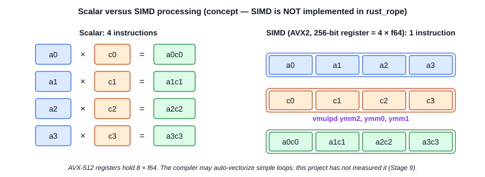

**Status in `rust_rope`:** **not implemented.** The code contains no
explicit SIMD. The compiler may auto-vectorize parts of simple loops, but
this has not been inspected or measured. The flat layout and the
`chunks_exact` loops are prerequisites for SIMD (Chapter 18). The scalar
code would remain as the reference for any SIMD version.

## Chapter 29: Parallelism with Rayon

**Rayon** is a Rust library for data parallelism: parallel iterators split
work between threads. **Status in `rust_rope`:** **not implemented**; the
project has no dependencies.

The concepts that Stage 9 would need: **work partitioning** (each thread
gets contiguous batch elements or tokens: the nested `chunks_exact_mut`
structure maps directly to `par_chunks_exact_mut`); **scheduling overhead**
(small tensors are faster on one thread); **false sharing** (two threads
that write to the same cache line slow each other down; contiguous chunks
avoid it); **data races** (Rust's borrow rules guarantee that the mutable
chunks do not overlap, so a parallel version cannot have data races in safe
code).

## Chapter 30: Benchmarking and Performance Results

### 30.1 Concepts

- **Latency:** the time for one operation (here: one tensor rotation).
- **Throughput:** the amount of work per time (here reported inversely, as
  nanoseconds per rotated pair).
- **Warm-up:** the first runs are slower (cold caches, page faults,
  frequency scaling); the benchmark runs 3 warm-up iterations first.
- **Repeated measurements:** the benchmark repeats each case 15 times and
  reports the **best** and the **median**; results vary between runs
  because of other processes, CPU frequency changes and memory placement.
- **Release builds:** `cargo bench` compiles with optimizations
  (`opt-level = 3`); a debug build is many times slower and not
  representative. No special flags (`target-cpu=native`, LTO) are set.

### 30.2 Configuration

Table: Benchmark environment

| Item | Value |
|---|---|
| CPU | AMD Ryzen 7 6800H with Radeon Graphics, 8 cores / 16 threads |
| Memory | 15.2 GiB |
| Operating system | Microsoft Windows 11 Home Single Language |
| Rust | rustc 1.99.1, target `x86_64-pc-windows-msvc` |
| Build | `cargo bench` default release profile, no extra flags |
| Method | `std::time::Instant`, 3 warm-up runs, 15 measured runs, best and median; inputs created outside the timed region |
| Base, layout | `b = 10 000`; interleaved unless stated |

### 30.3 Results

Measured with the current code (after Stage 8):

Table: Benchmark results with the current code (milliseconds)

| Operation | Shape `[B, S, H, D]` | Best | Median | ns per pair (best) |
|---|---|---|---|---|
| `rotate_tensor_in_place` | `[1, 128, 8, 64]` | 0.244 | 0.246 | 7.45 |
| `rotate_query_key` (q + k, 2 clones) | `[1, 128, 8, 64]` | 0.673 | 0.689 | 20.53 |
| `rotate_tensor_in_place` | `[1, 512, 8, 64]` | 1.098 | 1.103 | 8.38 |
| `rotate_query_key` | `[1, 512, 8, 64]` | 3.014 | 3.110 | 23.00 |
| `rotate_tensor_in_place` | `[2, 512, 16, 64]` | 4.342 | 4.431 | 8.28 |
| `rotate_query_key` | `[2, 512, 16, 64]` | 10.983 | 11.375 | 20.95 |
| interleaved, `d = 128` (full) | `[2, 512, 16, 128]` | 8.399 | 8.650 | 8.01 |
| interleaved, `d = 64` (partial) | `[2, 512, 16, 128]` | 7.201 | 7.948 | 6.87 |
| split-half, `d = 128` (full) | `[2, 512, 16, 128]` | 8.705 | 9.068 | 8.30 |
| split-half, `d = 64` (partial) | `[2, 512, 16, 128]` | 9.825 | 10.322 | 9.37 |

("ns per pair" divides by all `B·S·H·D/2` pairs of one tensor, also for
partial RoPE and for `rotate_query_key`, which rotates two tensors.)

### 30.4 Interpretation, and what we do not conclude

- The in-place time per pair is almost constant (7.5–8.4 ns): the cost is
  linear in the tensor size.
- `rotate_query_key` rotates two tensors and copies both: 2.5 to 2.8 times
  the in-place time of one tensor (two rotations plus about 3 ns per pair for
  the copies).
- **Partial RoPE** does half of the trigonometry, but interleaved `d = 64`
  was only 14 % faster than `d = 128`. The reason has **not** been measured;
  a possible reason is memory traffic (the 16 MiB tensor does not fit in
  the caches, and the prefetcher may still load the pass-through lines).
- **Layouts:** an earlier run of the same benchmark (before Stage 8)
  measured split-half `d = 64` at 8.21 ms; this run measured 9.83 ms. The
  difference between runs is larger than the difference between the
  layouts. **We do not conclude that one layout is faster.**
- No optimization has been implemented yet, so this guide reports no
  "improvement" numbers. A methodical baseline (for example with
  Criterion), profiling and one-change-at-a-time optimization are the plan
  of Stage 9.

# Part VIII — Putting Everything Together

## Chapter 31: Complete RoPE Execution Flow

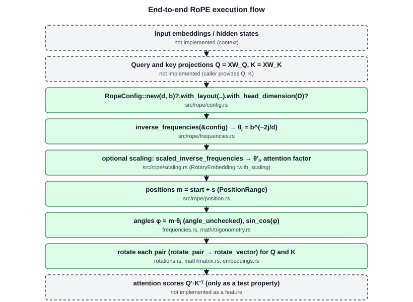

```text
Input embeddings                         not implemented (context)
      │
      ▼
Query and key projections                not implemented (the caller provides Q and K)
      │
      ▼
Generate inverse frequencies             src/rope/frequencies.rs   inverse_frequencies
      │                                  (RotaryEmbedding::new computes them once)
      ▼
Apply optional scaling                   src/rope/scaling.rs       scaled_inverse_frequencies
      │                                  (RotaryEmbedding::with_scaling)
      ▼
Generate positional angles               src/rope/position.rs      PositionRange::iter
      │                                  src/rope/frequencies.rs   angle_unchecked
      ▼
Rotate query and key                     src/rope/embeddings.rs    rotate_query_key[_in_place]
      │                                  src/rope/rotations.rs     rotate_pair
      │                                  src/math/matrix.rs        rotate_vector
      ▼
Compute attention scores                 not implemented (only tested as a property)
```

In this project the scaling step changes the frequencies **before** any
angle is calculated, so "apply optional scaling" happens once, at
construction.

## Chapter 32: Limitations and Future Work

### 32.1 Implemented

- `f64` RoPE for vectors and `[B, S, H, D]` query/key tensors, with a
  configurable start position.
- Interleaved and split-half layouts; partial rotation.
- Position interpolation, linear scaling, static NTK-aware scaling, YaRN
  (paper formulation, including the attention factor).
- Validation with typed errors; 298 Rust tests; an independent PyTorch
  reference with 288 cases; a simple benchmark.

### 32.2 Partially implemented

- **Benchmarking:** a simple `std::time` benchmark exists; no statistical
  methodology, no profiling.
- **Precomputation:** frequencies are cached and an `AngleTable` type
  exists, but no `cos`/`sin` cache is used by the rotation.
- **YaRN:** the paper formulation; the Hugging Face discretization and its
  extra options are not reproduced.

### 32.3 Planned or not supported

Table: Features that do not exist in rust_rope

| Feature | Status |
|---|---|
| Criterion benchmarks, profiling, loop variants | Planned (Stage 9) |
| `cos`/`sin` caches | Planned (Stage 9) |
| SIMD, Rayon parallelism | Planned (Stage 9) |
| `f32` computation path | Not supported (`f32` is studied only in the PyTorch comparison) |
| Dynamic NTK, LongRoPE | Studied but not implemented |
| Attention, softmax, masking, projections | Not supported (outside the scope) |
| KV cache, batched inference engine | Not supported |
| GPU, CUDA, Triton, tensor cores | Not supported |
| Quantization interactions | Not supported |

Possible future directions include GPU kernels, integration into an
inference engine with a KV cache (where the start position of new tokens
matters: `PositionRange::new(start, 1)`), and the interaction of RoPE with
quantized weights. **None of these exist in the project.**

# Appendices

## Glossary

Table: Glossary of technical terms

| Term | Definition |
|---|---|
| Attention | A layer that mixes token vectors with weights from query–key scores. |
| Batch (`B`) | A group of independent sequences processed together. |
| Base (`b`) | The constant in `θⱼ = b^(−2j/d)`; sets the slowest rotation speed. |
| Block-diagonal matrix | A matrix with square blocks on the diagonal and zeros elsewhere. |
| Borrow | Temporary access to a value through a reference `&` or `&mut`. |
| Cache line | The 64-byte unit in which memory moves between the cache levels. |
| Complex number | `a + bi` with `i² = −1`; a point in the plane. |
| Crate | A Rust compilation unit (library, binary, test, example). |
| Dot product | `Σ aᵢbᵢ`; measures the similarity of two vectors. |
| Embedding | The vector that represents a token. |
| Enum | A Rust type whose value is exactly one of a fixed set of variants. |
| Epsilon (`ε`) | The distance from 1.0 to the next representable floating-point number. |
| Euler's formula | `e^(iθ) = cos θ + i sin θ`. |
| Extrapolation | Using positions beyond the trained context length. |
| Head (`H`, `D`) | One of several parallel attention operations; `D` is its vector length. |
| Heap | Memory for data whose size is known only at run time. |
| IEEE 754 | The standard for binary floating-point arithmetic. |
| Interleaved layout | Pairs of adjacent components `(x₂ⱼ, x₂ⱼ₊₁)`. |
| Inverse frequency (`θⱼ`) | The rotation speed of pair `j`, in radians per position. |
| Key (`k`) | The vector that a token offers for comparison in attention. |
| Monomorphization | The compiler creates one copy of a generic function per concrete type. |
| Newtype | A struct with one field, used to create a distinct type (`Position`). |
| NTK-aware scaling | Scaling by a new base `b·s^(d/(d−2))`. |
| Orthogonal matrix | A matrix `Q` with `QᵀQ = I`; it keeps lengths and dot products. |
| Ownership | The Rust rule that each value has exactly one owner that frees it. |
| Partial RoPE | Rotation of only the first `d` of `D` head components. |
| Position (`m`) | The index of a token in its sequence. |
| Position interpolation | Scaling positions by `L/L'` into the trained range. |
| Query (`q`) | The vector with which a token looks for other tokens. |
| Radian | The angle unit: arc length divided by radius; a full turn is `2π`. |
| Relative position | The distance `n − m` between two tokens. |
| RoPE | Rotary Position Embedding: rotation of query and key pairs by `m·θⱼ`. |
| Rotary dimension (`d`) | The number of rotated components; the `d` in `θⱼ`. |
| Row-major order | Storage order in which the last index changes fastest. |
| SIMD | Single Instruction, Multiple Data: one instruction on several values. |
| Slice | A borrowed view of contiguous values (`&[T]`, `&mut [T]`). |
| Split-half layout | Pairs `(xⱼ, x_(j + d/2))`. |
| Stack | Memory for local values of fixed size; freed automatically. |
| Stride | The index step for a step of one along an axis. |
| Trait | A set of methods that a type can implement. |
| ulp | Unit in the last place: the spacing of floating-point numbers near a value. |
| Value (`v`) | The vector whose content attention mixes; not rotated by RoPE. |
| Wavelength (`λⱼ`) | `2π/θⱼ`: positions per full turn of pair `j`. |
| YaRN | A scaling method that treats frequency bands differently and scales attention. |

## References

1. Su, J., Lu, Y., Pan, S., Murtadha, A., Wen, B., Liu, Y. (2021). *RoFormer: Enhanced Transformer with Rotary Position Embedding.* arXiv:2104.09864.
2. Vaswani, A., et al. (2017). *Attention Is All You Need.* arXiv:1706.03762.
3. Shaw, P., Uszkoreit, J., Vaswani, A. (2018). *Self-Attention with Relative Position Representations.* arXiv:1803.02155.
4. Raffel, C., et al. (2020). *Exploring the Limits of Transfer Learning with a Unified Text-to-Text Transformer.* arXiv:1910.10683.
5. Touvron, H., et al. (2023). *LLaMA: Open and Efficient Foundation Language Models.* arXiv:2302.13971.
6. Chen, S., Wong, S., Chen, L., Tian, Y. (2023). *Extending Context Window of Large Language Models via Positional Interpolation.* arXiv:2306.15595.
7. bloc97 (2023). *NTK-Aware Scaled RoPE.* Online discussion post (r/LocalLLaMA).
8. Peng, B., Quesnelle, J., Fan, H., Shippole, E. (2023). *YaRN: Efficient Context Window Extension of Large Language Models.* arXiv:2309.00071.
9. Jacot, A., Gabriel, F., Hongler, C. (2018). *Neural Tangent Kernel: Convergence and Generalization in Neural Networks.* arXiv:1806.07572.
10. Tancik, M., et al. (2020). *Fourier Features Let Networks Learn High Frequency Functions in Low Dimensional Domains.* arXiv:2006.10739.
11. Hugging Face `transformers`, `modeling_rope_utils.py` (linear, dynamic NTK and YaRN parameter functions).
12. Goldberg, D. (1991). *What Every Computer Scientist Should Know About Floating-Point Arithmetic.* ACM Computing Surveys 23(1).
13. IEEE 754-2019. *IEEE Standard for Floating-Point Arithmetic.*
14. *The Rust Programming Language.* https://doc.rust-lang.org/book/
15. *The Rust Reference.* https://doc.rust-lang.org/reference/
16. *The Rust Performance Book.* https://nnethercote.github.io/perf-book/
17. PyTorch. https://pytorch.org (used only as validation tooling).
18. ASD-STE100. *Simplified Technical English.* ASD.

Project documents: `README.md`, `explain.md` (learning journal, Entries
1–16), `docs/mathematics.md`, `docs/architecture.md`, `docs/references.md`,
`reference/README.md`.
